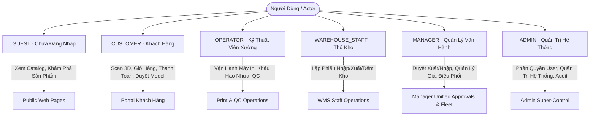
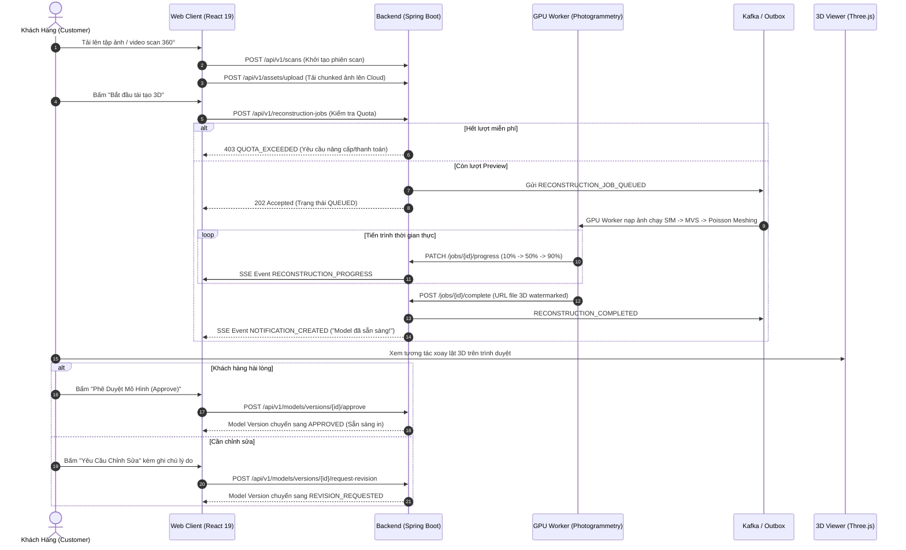
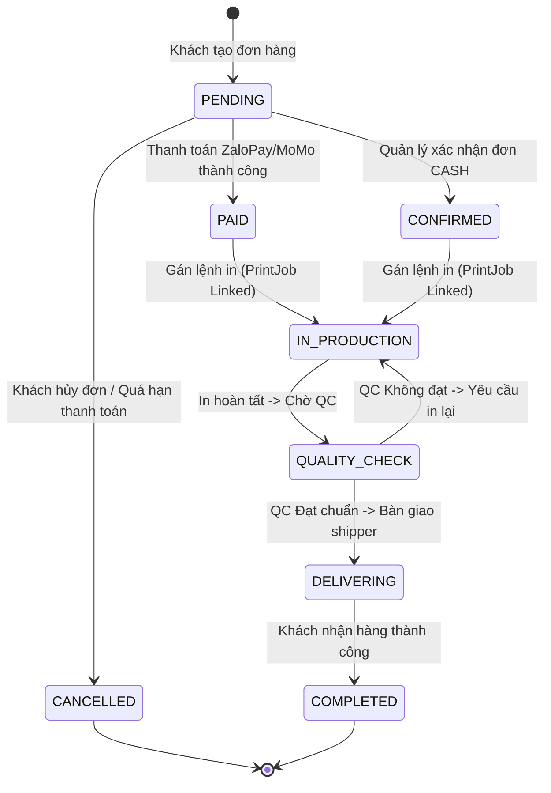

# 🌟 MEMENTO3D WEB PLATFORM — CẨM NANG TOÀN DIỆN
### Giới Thiệu Sản Phẩm, Tác Nhân (Actors), Quy Trình Nghiệp Vụ (Workflows) & Hướng Dẫn Vận Hành

---

## 📑 MỤC LỤC
1. [Tổng Quan Sản Phẩm (Product Overview)](#1-tổng-quan-sản-phẩm-product-overview)
2. [Các Tác Nhân & Ma Trận Phân Quyền (Actors & Permissions)](#2-các-tác-nhân--ma-trận-phân-quyền)
3. [Tất Cả Các Luồng Quy Trình Nghiệp Vụ (End-to-End Workflows)](#3-tất-cả-các-luồng-quy-trình-nghiệp-vụ)
   - [3.1. Luồng Quét Ảnh, Tái Tạo AI & Duyệt Mô Hình 3D (Scan & Freemium Review)](#31-luồng-quét-ảnh-tái-tạo-ai--duyệt-mô-hình-3d)
   - [3.2. Luồng Thương Mại Điện Tử & Giỏ Hàng (Catalog & Cart)](#32-luồng-thương-mại-điện-tử--giỏ-hàng)
   - [3.3. Luồng Đặt Hàng & Thanh Toán (Order & Payment State Machine)](#33-luồng-đặt-hàng--thanh-toán)
   - [3.4. Luồng Vận Hành Hạm Đội Máy In 3D (3D Print Farm Fleet)](#34-luồng-vận-hành-hạm-đội-máy-in-3d)
   - [3.5. Luồng Quản Trị Kho Đa Điểm & Kiểm Duyệt (WMS Enterprise)](#35-luồng-quản-trị-kho-đa-điểm--kiểm-duyệt)
   - [3.6. Luồng Kiểm Định Chất Lượng Sản Phẩm (Physical QC)](#36-luồng-kiểm-định-chất-lượng-sản-phẩm)
   - [3.7. Luồng Thông Báo Thời Gian Thực (Real-Time SSE & Kafka Relay)](#37-luồng-thông-báo-thời-gian-thực)
4. [Hướng Dẫn Thao Tác Giao Diện Người Dùng (UI Operation Guide)](#4-hướng-dẫn-thao-tác-giao-diện-người-dùng)
5. [Hướng Dẫn Cài Đặt & Trải Nghiệm Mẫu (Developer & Demo Walkthrough)](#5-hướng-dẫn-cài-đặt--trải-nghiệm-mẫu)

---

## 1. TỔNG QUAN SẢN PHẨM (PRODUCT OVERVIEW)

### 1.1. Sứ Mệnh & Bài Toán Giải Quyết
**Memento3D** là nền tảng thương mại điện tử kết hợp xưởng chế tác 3D thông minh (Bespoke 3D Manufacturing Platform). Hệ thống giải quyết trọn vẹn rào cản đưa công nghệ 3D vào đời sống:
- **Dân chủ hóa quét 3D:** Khách hàng chỉ cần sử dụng điện thoại thông minh chụp ảnh hoặc quay video 360° xung quanh đồ vật/kỷ vật, AI Photogrammetry (SfM/MVS) trên đám mây sẽ tự động tái tạo thành mô hình 3D kỹ thuật số độ chính xác cao.
- **Mô hình Freemium & Trải nghiệm tương tác trước khi mua:** Người dùng được cấp hạn ngạch xem trước mô hình 3D xoay lật 360° có watermark bản quyền trên trình duyệt (Three.js WebGL). Khách hàng duyệt mô hình (Approve) hoặc yêu cầu chỉnh sửa (Request Revision) trực tiếp trước khi quyết định in.
- **Sản xuất tự động khép kín:** Tự động tính toán lượng sợi nhựa/resin tiêu hao, trừ tồn kho kho vật tư theo thời gian thực, điều phối lệnh in tới hạm đội máy in (Prusa, BambuLab, Voron) và kiểm định chất lượng vật lý (QC) trước khi đóng gói giao hàng.

### 1.2. Hệ Thống Công Nghệ Hiện Đại
- **Frontend Web:** React 19, TypeScript, TanStack Query v5 (loại bỏ N+1 request và tối ưu staleTime), Ant Design 5, Lucide Icons, Vite tốc độ cao.
- **Backend Core:** Java 21+ / Java 25, Spring Boot 4.x, Hibernate 7, Spring Data JPA (loại bỏ N+1 queries bằng EntityGraph và DTO projection), Spring Security 6.x (Stateless JWT + OAuth2 Google).
- **Hệ Thống Sự Kiện & Thời Gian Thực:** Apache Kafka, Transactional Outbox Pattern, Server-Sent Events (SSE) đẩy thông báo và tiến trình in tức thời.
- **Cơ Sở Dữ Liệu:** PostgreSQL 16+ với 15 phiên bản Flyway Migration, Redis Caching & Distributed Locks.

---

## 2. CÁC TÁC NHÂN & MA TRẬN PHÂN QUYỀN

Hệ thống thiết kế theo cơ chế **Role-Based Access Control (RBAC)** kết hợp **Tenant/Warehouse Isolation**:



### 2.1. Ma Trận Phân Quyền Chi Tiết

| Tác nhân (Actor) | Vai trò (Role Code) | Trách nhiệm & Quyền hạn | Giao diện & Endpoint tiêu biểu |
| :--- | :--- | :--- | :--- |
| **GUEST** | `GUEST` (Chưa đăng nhập) | Xem giới thiệu trang chủ, khám phá danh mục sản phẩm nổi bật, tìm kiếm sản phẩm. Chưa thể checkout hoặc tạo scan. | `/`, `/products`, `/products/:slug` |
| **CUSTOMER** | `ROLE_USER` / `ROLE_CUSTOMER` | Tải ảnh scan 3D, xem trước mô hình 3D (Freemium), duyệt hoặc yêu cầu sửa model, quản lý giỏ hàng, đặt hàng, thanh toán (ZaloPay, MoMo, Tiền mặt), nhận thông báo đơn hàng realtime. | `/scans`, `/cart`, `/checkout`, `/orders`, `/orders/:id`, `/payment-result` |
| **OPERATOR** | `ROLE_OPERATOR` | Vận hành hạm đội máy in 3D, chuyển trạng thái Print Job (`PRINTING`, `COMPLETED`, `FAILED`), ghi nhận lượng gam nhựa tiêu hao thực tế, thực hiện biên bản kiểm định chất lượng (QC). | `/manager/print-jobs`, `/manager/quality-checks` |
| **WAREHOUSE_STAFF**| `ROLE_WAREHOUSE_STAFF` | Tạo dự thảo (DRAFT) phiếu nhập hàng (Goods Receipt), phiếu xuất kho (Stock Issue), phiếu chuyển kho (Warehouse Transfer), phiếu kiểm kê kho (Stock Count) cho kho được phân quyền. | `/manager/inventory`, `/manager/goods-receipts`, `/manager/stock-issues` |
| **MANAGER** | `ROLE_MANAGER` | Quản lý danh mục & sản phẩm bán hàng, phê duyệt toàn bộ phiếu kho tại **Unified Approvals Center**, điều phối máy in, xác nhận thanh toán tiền mặt (CASH), giám sát dashboard kho. | `/manager/dashboard`, `/manager/approvals`, `/manager/products`, `/manager/orders` |
| **ADMIN** | `ROLE_ADMIN` | Toàn quyền kiểm soát hệ thống: quản lý tài khoản người dùng, phân quyền thành viên kho (`WarehouseMembership`), xem Audit Logs, cấu hình máy in và thông số hệ thống. | `/admin/users`, `/admin/warehouses`, `/admin/audit-logs` |

### 2.2. Danh Sách Tài Khoản Thử Nghiệm (Seed Credentials)
*Mật khẩu mặc định cho toàn bộ tài khoản thử nghiệm:* **`password123`**
- **Admin:** `admin@memento3d.com`
- **Manager:** `manager@memento3d.com`
- **Operator:** `operator@memento3d.com`
- **Warehouse Staff:** `warehouse@memento3d.com`
- **Customer:** `customer@memento3d.com`

---

## 3. TẤT CẢ CÁC LUỒNG QUY TRÌNH NGHIỆP VỤ

### 3.1. Luồng Quét Ảnh, Tái Tạo AI & Duyệt Mô Hình 3D



### 3.2. Luồng Thương Mại Điện Tử & Giỏ Hàng
1. Khách hàng duyệt trang **Cửa Hàng (`/products`)**, lọc theo danh mục (Quà tốt nghiệp, tượng bán thân, móc khóa charm...), khoảng giá và mức độ phổ biến.
2. Dữ liệu danh mục được cache trong 10 phút (`staleTime: 10m`), chuyển trang mượt mà không tải lại toàn bộ.
3. Bấm vào chi tiết sản phẩm, khách hàng tùy chọn:
   - Kích thước chế tác (Mini 8-10cm, Standard 12-15cm, Large 18-20cm).
   - Chất liệu in (High-Detail Resin, PLA Matte, PETG Pro).
   - Đế trưng bày (Gỗ Walnut, Đế Led phát sáng).
   - Ghi chú khắc tên cá nhân hóa.
4. Thêm vào giỏ hàng (`CartContext` đồng bộ dữ liệu với LocalStorage và Backend).

### 3.3. Luồng Đặt Hàng & Thanh Toán (Order State Machine)



### 3.4. Luồng Vận Hành Hạm Đội Máy In 3D (3D Print Farm Fleet)
1. **Liên kết lệnh in:** Tại trang Quản lý đơn hàng (`/manager/orders`), Manager mở modal gán in (`OrderPrintJobLinkModal`), chọn máy in trong fleet (Prusa, BambuLab) và loại vật liệu tương ứng.
2. **Khấu hao vật tư:** Khi Print Job chuyển sang `PRINTING`, hệ thống tự động khóa (reserve) lượng nhựa ước tính trong kho vật tư.
3. **Giám sát trực tiếp:** Kỹ thuật viên (Operator) cập nhật tiến độ in thực tế qua màn hình `/manager/print-jobs`, nhận thông báo WebSocket/SSE khi máy in hoàn thành hoặc gặp sự cố nghẹt đầu phun/đứt sợi (spool runout).

### 3.5. Luồng Quản Trị Kho Đa Điểm (WMS Enterprise)
- **Kiểm soát phân quyền theo kho:** Nhân viên kho chỉ thao tác trên kho được chỉ định (`activeWarehouse`).
- **Trung Tâm Duyệt Lệnh Hợp Nhất (`/manager/approvals`):**
  - Quản lý duyệt phiếu nhập hàng (Goods Receipt) -> Tăng số dư tồn kho (`onHandGram`).
  - Quản lý duyệt phiếu xuất kho (Stock Issue) -> Giảm số dư khả dụng, ghi nhận thẻ kho (`InventoryTransaction`).
  - Quản lý duyệt phiếu điều chuyển (Warehouse Transfer) -> Chuyển hàng giữa các chi nhánh có mã vận đơn theo dõi.
  - Quản lý duyệt phiếu kiểm kê (Stock Count) -> Tự động cân chỉnh chênh lệch thực tế và sổ sách qua phiếu điều chỉnh (`StockAdjustment`).

### 3.6. Luồng Kiểm Định Chất Lượng Sản Phẩm (Physical QC)
- Sau khi máy in hoàn tất, sản phẩm chuyển sang trạng thái chờ kiểm định chất lượng:
  - Kiểm tra độ hoàn thiện bề mặt (Layer lines, stringing).
  - Cân trọng lượng thực tế so với file slice.
  - Đo kích thước 3 chiều (sai số < 0.2mm).
- Nếu Đạt: Kỹ thuật viên bấm **Approve QC**, kích hoạt chuyển trạng thái đơn hàng sang `DELIVERING`.
- Nếu Không đạt: Ghi nhận lỗi (Warping, Under-extrusion), hệ thống tự động sinh Print Job bù đắp và bảo lưu tiến trình đơn hàng.

### 3.7. Luồng Thông Báo Thời Gian Thực (Real-Time SSE & Kafka Relay)
- **Top Navbar Notification Center:** Biểu tượng chuông thông báo hiển thị số lượng chưa đọc.
- Khi có bất kỳ sự kiện nào (đơn hàng mới, thanh toán hoàn tất, in xong, model sẵn sàng), Kafka gửi message -> Backend SSE relay -> Web tự động hiển thị Toast thông báo và tự động refresh dữ liệu mà người dùng không cần bấm F5.

---

## 4. HƯỚNG DẪN THAO TÁC GIAO DIỆN NGƯỜI DÙNG (UI OPERATION GUIDE)

### 4.1. Dành Cho Khách Hàng (Customer Walkthrough)
1. **Đăng nhập:** Truy cập `/login`, chọn đăng nhập tài khoản thường hoặc Google OAuth2.
2. **Quét 3D mới:** Vào mục **Scan 3D (`/scans`)**, nhấn "Tạo phiên quét mới", tải lên từ 20 đến 100 ảnh góc chụp 360° của vật thể.
3. **Xem và Duyệt Model 3D:**
   - Sau khi AI hoàn tất, mở trang chi tiết phiên quét.
   - Xoay, phóng to, thu nhỏ mô hình trên trình xem 3D trực quan.
   - Nhấn **"Phê Duyệt Mô Hình"** để chuyển sang đặt in vật lý.
4. **Đặt hàng & Thanh toán:**
   - Chọn quy cách in và bấm "Thêm vào giỏ".
   - Vào Giỏ hàng (`/cart`) -> Bấm "Tiến hành thanh toán".
   - Nhập thông tin người nhận, chọn phương thức (ZaloPay hoặc Tiền mặt khi nhận hàng - CASH).
   - Sau khi đặt đơn thành công, theo dõi trạng thái đơn hàng trực tiếp tại `/orders`.

### 4.2. Dành Cho Manager & Operator (Quản Lý & Vận Hành)
1. **Chuyển đổi kho hoạt động:** Ở thanh Header, nhấp vào menu chọn kho để chuyển giữa các cơ sở (ví dụ: *Kho Tổng Hà Nội - WH-HN-01* hoặc *Chi Nhánh Đà Nẵng*).
2. **Kiểm duyệt nghiệp vụ kho:**
   - Vào **Unified Approvals Center (`/manager/approvals`)**.
   - Chuyển giữa các tab: *Goods Receipts* (Nhập hàng), *Stock Issues* (Xuất kho), *Adjustments* (Cân chỉnh), *Transfers* (Điều chuyển).
   - Bấm **"Approve"** hoặc **"Reject"** trực tiếp trên từng dòng.
3. **Điều phối in 3D:**
   - Vào **Quản lý đơn hàng (`/manager/orders`)**, chọn đơn đang ở trạng thái `PAID` hoặc `CONFIRMED`.
   - Bấm **"Gán máy in"**, chọn máy in còn trống và loại sợi nhựa thích hợp.
   - Theo dõi trạng thái in tại `/manager/print-jobs`.

---

## 5. HƯỚNG DẪN CÀI ĐẶT & TRẢI NGHIỆM MẪU

### 5.1. Khởi Chạy Backend (Spring Boot)
```bash
# Di chuyển vào thư mục backend
cd Memento3D-Backend/memeto3D

# Biên dịch và chạy ứng dụng
./mvnw spring-boot:run
```
Máy chủ API sẵn sàng tại: `http://localhost:8080/api/v1`

### 5.2. Khởi Chạy Frontend (React Vite)
```bash
# Di chuyển vào thư mục frontend web
cd Memento3D-Fronted-Web

# Cài đặt thư viện nếu chạy lần đầu
npm install

# Khởi chạy máy chủ phát triển
npm run dev
```
Trang web mở tại: `http://localhost:5173/`

---
*Tài liệu được biên soạn và bảo trì bởi Đội ngũ Kiến trúc Công nghệ **Memento3D**.*
