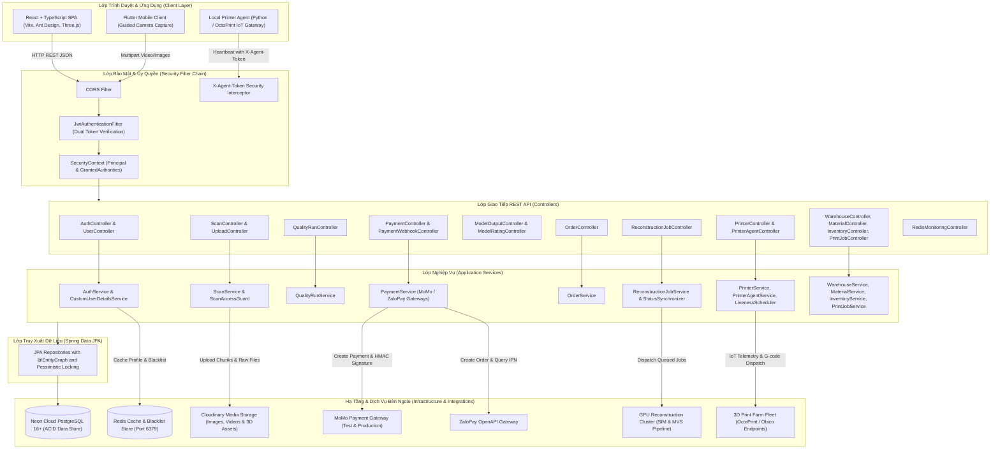

# 01 — KIẾN TRÚC HỆ THỐNG MEMENTO3D (SYSTEM ARCHITECTURE)

---

## 1. Phong Cách Kiến Trúc: Modular Monolith

Hệ thống Memento3D được xây dựng theo mô hình **Modular Monolith** kết hợp nguyên lý **Package-by-Feature / Domain-Driven Design (DDD)** nhẹ. Toàn bộ logic nghiệp vụ, quản lý phiên scan, tái tạo 3D, thanh toán, kho vận (WMS) và điều khiển máy in 3D được đóng gói trong một ứng dụng Spring Boot duy nhất, chia thành các bounded context độc lập để dễ dàng bảo trì và sẵn sàng tách thành microservices trong tương lai nếu lưu lượng tăng trưởng đột biến.

---

## 2. Sơ Đồ Kiến Trúc Tổng Thể (C4 Container Diagram)



---

## 3. Cấu Trúc Thư Mục Source Code Backend Hiện Tại

Mã nguồn backend nằm tại thư mục `Memento3D-Backend/memeto3D/src/main/java/com/memento3d`:

```text
com.memento3d
├── Memento3DApplication.java        # Spring Boot Main Entry Point
├── assets/                           # Tải lên phân mảnh và quản lý file chunks
│   ├── api/                          # UploadController
│   ├── application/service/          # UploadService, UploadServiceImpl
│   ├── domain/model/                 # UploadSession, UploadChunk
│   └── infrastructure/               # CloudinaryStorageService, UploadRepository
├── identity/                         # Xác thực, người dùng, OAuth2, bảo mật token
│   ├── api/                          # AuthController, UserController
│   ├── application/service/          # AuthService, UserService, TokenBlacklistService
│   ├── domain/model/                 # User, Role, RefreshToken, BlacklistedToken
│   └── infrastructure/security/      # JWT Filter, CustomUserDetails, OAuth2 Handlers
├── inventory/                        # Quản lý kho WMS: Tồn kho, nhập/xuất kho, thẻ kho
│   ├── api/                          # InventoryController
│   ├── application/service/          # InventoryService, InventoryServiceImpl
│   ├── domain/model/                 # InventoryBalance, InventoryTransaction, StockReceipt, StockIssue, StockReservation
│   └── infrastructure/persistence/   # Inventory Repositories
├── material/                         # Danh mục vật tư in 3D & đơn giá
│   ├── api/                          # MaterialController
│   ├── application/service/          # MaterialService, MaterialServiceImpl
│   └── domain/model/                 # Material, MaterialType, MaterialStatus
├── models/                           # Mô hình 3D hoàn thiện và đánh giá
│   ├── api/                          # ModelOutputController, ModelRatingController
│   ├── application/service/          # ModelOutputService, ModelRatingService
│   └── domain/model/                 # ModelOutput, ModelRating
├── operations/                       # Giám sát hạ tầng kỹ thuật
│   ├── api/                          # RedisMonitoringController
│   └── application/service/          # RedisMonitoringService
├── orders/                           # Thương mại & đơn hàng in 3D cá nhân hóa
│   ├── api/                          # OrderController
│   ├── application/service/          # OrderService, OrderServiceImpl
│   └── domain/model/                 # Order, OrderStatus
├── payment/                          # Cổng thanh toán trực tuyến MoMo & ZaloPay
│   ├── api/                          # PaymentController, PaymentWebhookController
│   ├── application/service/          # PaymentService, PaymentServiceImpl
│   ├── domain/model/                 # PaymentTransaction, PaymentStatus, PaymentMethod
│   └── infrastructure/gateway/       # MomoPaymentGateway, ZaloPayPaymentGateway
├── printers/                         # Quản lý đội máy in 3D & Local Agent IoT Gateway
│   ├── api/                          # PrinterController, PrinterAgentController, AgentGatewayController
│   ├── application/service/          # PrinterService, PrinterAgentService, LivenessScheduler
│   └── domain/model/                 # Printer, PrinterAgent, PrinterStatus
├── printjob/                         # Điều phối lệnh in 3D & ghi nhận tiêu hao vật tư
│   ├── api/                          # PrintJobController
│   ├── application/service/          # PrintJobService, PrintJobServiceImpl
│   └── domain/model/                 # PrintJob, PrintJobConsumption
├── quality/                          # Đánh giá chất lượng ảnh scan đầu vào (QC)
│   ├── api/                          # QualityRunController
│   ├── application/service/          # QualityRunService, QualityRunServiceImpl
│   └── domain/model/                 # QualityCheckRun, ImageQualityResult
├── reconstruction/                   # Tái tạo 3D bằng AI (Job Queue & Sync)
│   ├── api/                          # ReconstructionJobController
│   ├── application/service/          # ReconstructionJobService, Dispatcher, Synchronizer
│   └── domain/model/                 # ReconstructionJob, ReconstructionJobStatus
├── scans/                            # Quản lý phiên scan 3D của người dùng
│   ├── api/                          # ScanController
│   ├── application/service/          # ScanService, ScanAccessGuard
│   └── domain/model/                 # Scan, ScanImage, ScanVideo
├── shared/                           # Tiện ích, cấu hình bảo mật toàn cục, ngoại lệ
│   ├── config/                       # FlywayConfig, RedisConfig, WebMvcConfig
│   ├── exception/                    # GlobalExceptionHandler, BusinessException
│   └── security/                     # SecurityConfig, JwtTokenProvider, JwtAuthenticationFilter
└── warehouse/                        # Cơ sở kho vật lý & phân bổ nhân sự kho
    ├── api/                          # WarehouseController
    ├── application/service/          # WarehouseService, WarehouseSecurityService
    └── domain/model/                 # Warehouse, WarehouseMembership, WarehouseRole
```

---

## 4. Vấn Đề Kiến Trúc & Đề Xuất Cấu Trúc Mục Tiêu (Target Clean Architecture)

### ⚠ Vấn đề hiện tại:
1. Một số package sử dụng quy ước đặt tên chưa đồng nhất: thư mục gốc đặt tên là `memeto3D` (thiếu chữ 'n'), trong khi package Java là `com.memento3d`.
2. Package `assets` và `scans` có sự phụ thuộc chéo (Circular dependency tiềm tàng) khi upload ảnh scan chunked.
3. Việc cấu hình OpenAPI `/swagger-ui/**` cần tiếp tục duy trì tương thích khi nâng cấp các bản Springdoc OpenAPI mới trên Spring Boot 4.x.

### Kiến trúc mục tiêu khuyến nghị (Target Package Structure):
- Tiếp tục duy trì chuẩn **Clean Architecture / Hexagonal** bên trong mỗi feature package:
  `api` (Inbound Ports/Adapters) &rarr; `application` (Use Cases) &rarr; `domain` (Entities & Business Rules) &rarr; `infrastructure` (Outbound Adapters: JPA, Redis, Cloudinary, Third-party Gateways).
