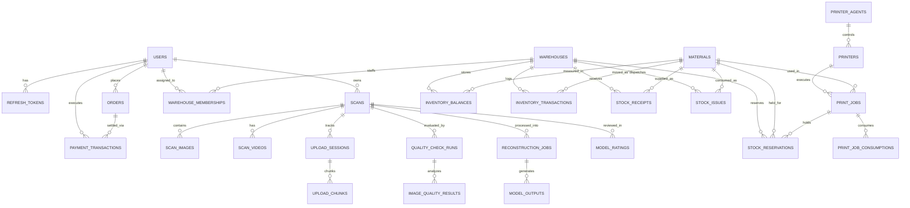

# 02 — THIẾT KẾ CƠ SỞ DỮ LIỆU MEMENTO3D (DATABASE DESIGN)

---

## 1. Tổng Quan Cơ Sở Dữ Liệu

- **Hệ quản trị CSDL:** PostgreSQL 16+ (Lưu trữ trên cụm Neon Cloud Serverless Database).
- **Cơ chế quản lý Migration:** Flyway (`src/main/resources/db/migration`).
- **Quy ước khóa chính:** Toàn bộ bảng sử dụng khóa chính dạng **UUID (v4)** để đảm bảo tính phân tán, an toàn trước tấn công duyệt ID tuần tự (IDOR enumeration).
- **Thời gian (Timestamps):** `created_at` và `updated_at` sử dụng kiểu dữ liệu `TIMESTAMP WITH TIME ZONE` (UTC).
- **Xóa mềm (Soft Delete):** Áp dụng cột `deleted_at TIMESTAMP WITH TIME ZONE NULL` cho các bảng quan trọng (`scans`, `users`, `materials`).

---

## 2. Sơ Đồ Thực Thể Liên Kết (Entity-Relationship Diagram - ERD)

---

## 3. Danh Mục Các Bảng Dữ Liệu (Table Catalog)

### 3.1. Phân Hệ Người Dùng & Bảo Mật (Identity)
| Tên Bảng | Mục Đích | Các Cột Quan Trọng | Ràng Buộc & Chỉ Mục |
| :--- | :--- | :--- | :--- |
| `users` | Lưu trữ tài khoản người dùng, vai trò hệ thống và quota dung lượng | `id` (UUID PK), `email` (VARCHAR UK), `password_hash`, `full_name`, `role` (CHECK: ROLE_USER, ROLE_ADMIN, ROLE_MANAGER, ROLE_WAREHOUSE, ROLE_OPERATOR, ROLE_PROVIDER, ROLE_DRIVER), `storage_quota_bytes`, `storage_used_bytes`, `is_active` | `users_email_key` (UNIQUE), `idx_users_email` |
| `refresh_tokens` | Lưu Refresh Token phục vụ cơ chế JWT rotation | `id` (UUID PK), `user_id` (FK), `token` (VARCHAR UK), `token_family` (UUID), `is_revoked`, `expires_at` | `idx_refresh_tokens_token`, `idx_refresh_tokens_family` |
| `blacklisted_tokens` | Danh sách đen Access Token đã bị thu hồi khi đăng xuất | `id` (UUID PK), `token` (VARCHAR UK), `revoked_at`, `expires_at` | `idx_blacklisted_tokens_expires_at` (hỗ trợ cron dọn dẹp) |

### 3.2. Phân Hệ Scan & Đánh Giá Chất Lượng (Scans & QC)
| Tên Bảng | Mục Đích | Các Cột Quan Trọng | Ràng Buộc & Chỉ Mục |
| :--- | :--- | :--- | :--- |
| `scans` | Phiên chụp ảnh/video quét vật thể 3D | `id` (UUID PK), `user_id` (FK), `name`, `status` (draft, uploading, uploaded, quality_check, ready, processing, done, failed, deleted), `input_mode` (images, video), `deleted_at` | `idx_scans_user_id`, `idx_scans_status` |
| `scan_images` | Danh sách ảnh chụp trong phiên scan | `id` (UUID PK), `scan_id` (FK), `original_filename`, `storage_path`, `file_size_bytes`, `image_order` | `idx_scan_images_scan_id` |
| `scan_videos` | Tệp video quay 360 độ vật thể | `id` (UUID PK), `scan_id` (FK), `storage_path`, `duration_seconds`, `fps` | `idx_scan_videos_scan_id` |
| `quality_check_runs` | Lần chạy đánh giá chất lượng ảnh scan | `id` (UUID PK), `scan_id` (FK), `overall_score`, `status` (green, amber, red), `total_images`, `passed_images`, `is_overridden` | `idx_quality_runs_scan_id` |
| `image_quality_results` | Chi tiết điểm kiểm tra từng bức ảnh | `id` (UUID PK), `quality_run_id` (FK), `scan_image_id` (FK), `blur_score`, `brightness_score`, `is_duplicate`, `is_blurry`, `is_under_exposed`, `is_over_exposed` | `idx_image_quality_run_id` |

### 3.3. Phân Hệ Tái Tạo 3D & Sản Phẩm (Reconstruction & Models)
| Tên Bảng | Mục Đích | Các Cột Quan Trọng | Ràng Buộc & Chỉ Mục |
| :--- | :--- | :--- | :--- |
| `reconstruction_jobs` | Hàng đợi tác vụ tái tạo mô hình 3D trên GPU | `id` (UUID PK), `scan_id` (FK), `status` (queued, running, done, failed, cancelled), `stage` (preprocessing, sfm, mvs, meshing, texturing, completed), `progress` (0-100) | `idx_recon_jobs_status`, `idx_recon_jobs_scan_id` |
| `model_outputs` | Tệp mô hình 3D hoàn thiện sẵn sàng tải/in | `id` (UUID PK), `reconstruction_job_id` (FK), `scan_id` (FK), `format` (GLB, STL, OBJ), `storage_path`, `vertex_count`, `face_count`, `file_size_bytes` | `idx_model_outputs_scan_id` |
| `model_ratings` | Phản hồi và chấm điểm sao của người dùng | `id` (UUID PK), `scan_id` (FK), `user_id` (FK), `rating` (1-5 sao), `comment` | `idx_model_ratings_scan_id` |

### 3.4. Phân Hệ Thương Mại & Thanh Toán (Orders & Payments)
| Tên Bảng | Mục Đích | Các Cột Quan Trọng | Ràng Buộc & Chỉ Mục |
| :--- | :--- | :--- | :--- |
| `orders` | Đơn hàng đặt in 3D kỷ niệm | `id` (UUID PK), `user_id` (FK), `scan_id` (FK), `total_price` (NUMERIC), `currency` (VND), `status` (PENDING_PAYMENT, CONFIRMED, PRINTING, SHIPPED, DELIVERED, CANCELLED, REFUNDED), `recipient_name`, `shipping_address`, `phone` | `idx_orders_user_id`, `idx_orders_status` |
| `payment_transactions` | Nhật ký giao dịch cổng thanh toán | `id` (UUID PK), `order_id` (FK), `user_id` (FK), `payment_method` (MOMO, ZALOPAY), `amount`, `status` (PENDING, PROCESSING, SUCCESS, FAILED, CANCELLED, REFUNDED), `merchant_transaction_id`, `provider_transaction_id` | `idx_pay_tx_order_id`, `idx_pay_tx_merchant_ref` |

### 3.5. Phân Hệ Máy In 3D & Phần Cứng (3D Printers & IoT Agents)
| Tên Bảng | Mục Đích | Các Cột Quan Trọng | Ràng Buộc & Chỉ Mục |
| :--- | :--- | :--- | :--- |
| `printer_agents` | Phần mềm Gateway kết nối cụm máy in OctoPrint | `id` (UUID PK), `agent_name`, `token_hash` (BCrypt), `status` (ONLINE, OFFLINE, REVOKED), `last_heartbeat_at`, `ip_address` | `idx_printer_agents_status` |
| `printers` | Thiết bị máy in 3D trong xưởng | `id` (UUID PK), `agent_id` (FK), `name`, `model_name`, `provider` (OCTOPRINT, OBICO), `status` (IDLE, PRINTING, OFFLINE, ERROR, PAUSED), `current_job_id`, `bed_temp`, `nozzle_temp` | `idx_printers_agent_id`, `idx_printers_status` |

### 3.6. Phân Hệ Quản Lý Kho & Vật Tư (WMS: Warehouses & Inventory)
| Tên Bảng | Mục Đích | Các Cột Quan Trọng | Ràng Buộc & Chỉ Mục |
| :--- | :--- | :--- | :--- |
| `warehouses` | Cơ sở kho hàng vật lý theo khu vực | `id` (UUID PK), `code` (VARCHAR UK, e.g. WH-HCM-01), `name`, `address`, `status` (ACTIVE, INACTIVE), `capacity_bins` | `idx_warehouses_code` (UNIQUE) |
| `warehouse_memberships` | Phân bổ quyền hạn nhân sự theo từng kho | `id` (UUID PK), `warehouse_id` (FK), `user_id` (FK), `role` (MANAGER, WAREHOUSE_STAFF, PRINT_OPERATOR), `status` (ACTIVE, INACTIVE) | `idx_wh_members_user_wh` (UNIQUE) |
| `materials` | Danh mục vật liệu in 3D (PLA, Resin, PETG...) | `id` (UUID PK), `sku` (VARCHAR UK), `name`, `type` (FILAMENT_PLA, RESIN_TOUGH...), `color`, `density_g_cm3`, `price_per_gram`, `safety_stock_grams`, `status` | `idx_materials_sku` (UNIQUE) |
| `inventory_balances` | Tồn kho thực tế và lượng đã giữ chỗ | `id` (UUID PK), `warehouse_id` (FK), `material_id` (FK), `lot_number`, `quantity_grams`, `reserved_grams`, `bin_location` | `idx_inv_bal_wh_mat_lot` (UNIQUE) |
| `inventory_transactions` | Sổ cái biến động kho (Double-entry Ledger) | `id` (UUID PK), `warehouse_id` (FK), `material_id` (FK), `lot_number`, `type` (NHAP_KHO, XUAT_KHO, GIU_CHO, HUY_GIU_CHO, XUAT_SAN_XUAT, HOAN_NHAP), `quantity_grams`, `balance_after_grams`, `reference_doc_id` | `idx_inv_tx_created_at` |
| `stock_receipts` | Phiếu nhập kho vật tư (GRN) | `id` (UUID PK), `receipt_number` (UK), `warehouse_id` (FK), `material_id` (FK), `lot_number`, `quantity_grams`, `unit_cost_vnd`, `supplier_name` | `idx_stock_receipts_num` (UNIQUE) |
| `stock_issues` | Phiếu xuất kho thủ công hoặc điều chuyển (GIN)| `id` (UUID PK), `issue_number` (UK), `warehouse_id` (FK), `material_id` (FK), `lot_number`, `quantity_grams`, `reason`, `receiver_name` | `idx_stock_issues_num` (UNIQUE) |
| `stock_reservations` | Giữ chỗ vật tư cho lệnh in 3D | `id` (UUID PK), `print_job_id` (FK), `warehouse_id` (FK), `material_id` (FK), `reserved_grams`, `status` (PENDING, CONSUMED, CANCELLED) | `idx_stock_res_job_id` |
| `print_jobs` | Lệnh in 3D thực tế trên máy in | `id` (UUID PK), `printer_id` (FK), `material_id` (FK), `status` (PENDING, RESERVED, PRINTING, COMPLETED, FAILED, CANCELLED), `estimated_grams`, `gcode_path` | `idx_print_jobs_status` |
| `print_job_consumptions`| Quyết toán lượng tiêu hao thực tế sau in | `id` (UUID PK), `print_job_id` (FK), `warehouse_id` (FK), `material_id` (FK), `actual_consumed_grams`, `waste_grams` | `idx_print_consump_job_id` |
