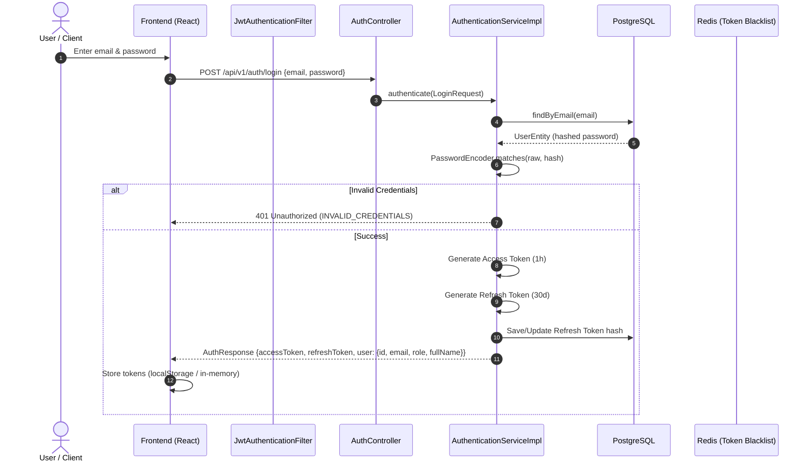
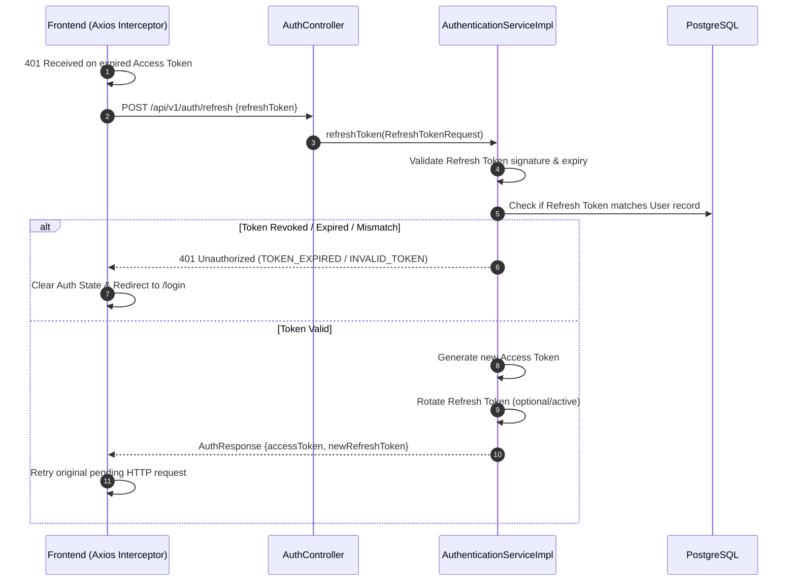
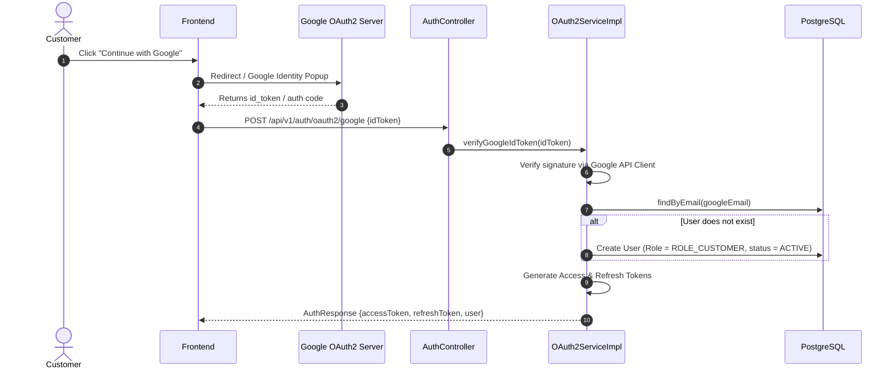

# MEMENTO3D — AUTHENTICATION & SECURITY GUIDE

## 1. Overview
Hệ thống xác thực và phân quyền của Memento3D được xây dựng trên nền tảng **Spring Security 6.x** kết hợp cơ chế **Stateless JWT (JSON Web Token)** với Dual-Token Pattern (Access Token + Refresh Token), Google OAuth2 Authentication, và Role-Based Access Control (RBAC).

---

## 2. Authentication Flows

### 2.1 Standard Email / Password Flow

### 2.2 Token Refresh Flow

### 2.3 Google OAuth2 Flow

---

## 3. Token Specifications

| Thuộc tính | Access Token | Refresh Token |
|---|---|---|
| **Thuật toán** | `HS256` (HMAC with SHA-256) | `HS256` (HMAC with SHA-256) |
| **Thời hạn sống (TTL)** | 1 giờ (`3600000 ms`) | 30 ngày (`2592000000 ms`) |
| **Key Secret config** | `jwt.secret` (Base64 hoặc chuỗi 256-bit) | `jwt.secret` |
| **Claims chứa** | `sub` (userId/email), `role`, `iat`, `exp` | `sub` (userId), `type: refresh`, `iat`, `exp` |
| **Vị trí lưu trữ FE** | LocalStorage (`auth_token` / `memento3d_token`) | LocalStorage (`refresh_token`) |
| **Phương thức truyền** | `Authorization: Bearer <accessToken>` | JSON Body trong `/auth/refresh` |
| **Revocation Check** | Redis Blacklist (`blacklist:token:<jti/token>`) | Database DB comparison & Redis revoke |

---

## 4. Role-Based Access Control (RBAC) Matrix

Hệ thống định nghĩa 7 Roles cốt lõi trong Enum `Role`:
- `ROLE_ADMIN`
- `ROLE_MANAGER`
- `ROLE_OPERATOR`
- `ROLE_WAREHOUSE`
- `ROLE_CUSTOMER`
- `ROLE_PROVIDER`
- `ROLE_DRIVER`

### 4.1 Chi tiết bảng phân quyền API thực tế

| API Path Prefix | Roles được phép | Mô tả quyền hạn |
|---|---|---|
| `/api/v1/auth/**` | **PUBLIC** | Đăng ký, đăng nhập, refresh token, OAuth2 Google |
| `/api/v1/scans/upload` | `ROLE_CUSTOMER`, `ROLE_ADMIN` | Tải ảnh lên tạo 3D Reconstruction |
| `/api/v1/scans/{id}` | Owner (`ROLE_CUSTOMER`), `ROLE_ADMIN`, `ROLE_MANAGER` | Đọc chi tiết phiên Scan |
| `/api/v1/scans/qc/**` | `ROLE_OPERATOR`, `ROLE_MANAGER`, `ROLE_ADMIN` | Duyệt QC chất lượng ảnh scan |
| `/api/v1/models/**` | Owner (`ROLE_CUSTOMER`), `ROLE_ADMIN` | Xem & tải mô hình 3D (STL/OBJ/GLB) |
| `/api/v1/orders` (POST) | `ROLE_CUSTOMER`, `ROLE_ADMIN` | Đặt in mô hình 3D |
| `/api/v1/orders` (GET) | Owner / `ROLE_MANAGER`, `ROLE_ADMIN`, `ROLE_PROVIDER` | Danh sách đơn hàng |
| `/api/v1/payments/**` | `ROLE_CUSTOMER`, Webhook Public (MoMo, ZaloPay) | Khởi tạo & callback thanh toán |
| `/api/v1/printers/**` | `ROLE_ADMIN`, `ROLE_MANAGER`, `ROLE_OPERATOR` | Quản lý máy in 3D |
| `/api/v1/printers/agent/**`| **IOT AGENT** (`X-Agent-Token`) | Cổng kết nối OctoPrint Agent |
| `/api/v1/print-jobs/**` | `ROLE_ADMIN`, `ROLE_MANAGER`, `ROLE_OPERATOR` | Điều phối lệnh in |
| `/api/v1/wms/**` | `ROLE_ADMIN`, `ROLE_MANAGER`, `ROLE_WAREHOUSE`, `ROLE_OPERATOR` | Quản trị kho vật liệu & định mức |

---

## 5. Security Filters & Pipeline

Trong `SecurityConfig.java`:

1. **CorsFilter**: Cấu hình CORS cho Frontend (`http://localhost:5173`, `https://*.memento3d.vn`). Cho phép các HTTP Methods: `GET`, `POST`, `PUT`, `PATCH`, `DELETE`, `OPTIONS`. Headers: `Authorization`, `Content-Type`, `X-Agent-Token`, `Accept`.
2. **CsrfFilter**: Vô hiệu hóa (`csrf.disable()`) vì API là stateless REST, sử dụng JWT Bearer Token trong Authorization Header (không bị CSRF attack như cookie-based).
3. **SessionManagement**: Đặt ở chế độ `SessionCreationPolicy.STATELESS`.
4. **JwtAuthenticationFilter**:
   - Trích xuất token từ header `Authorization: Bearer <token>`.
   - Bỏ qua các endpoint public (`/api/v1/auth/**`, `/swagger-ui/**`, `/v3/api-docs/**`, webhooks).
   - Kiểm tra Redis Blacklist xem token đã bị logout chưa.
   - Parse claims qua `JwtService.validateToken(token)`.
   - Nạp `UserDetails` vào `SecurityContextHolder.getContext().setAuthentication(...)`.
5. **OctoPrintAgentAuthFilter** / **Header Check**:
   - Dành riêng cho endpoint IoT Agent `/api/v1/printers/agent/**`.
   - Xác thực token bí mật `X-Agent-Token` được cấp riêng cho từng máy in / Raspberry Pi chạy OctoPrint.
6. **AuthenticationEntryPoint & AccessDeniedHandler**:
   - `401 Unauthorized`: Trả về JSON chuẩn RFC 7807 hoặc ApiResponse thống nhất `{"success": false, "message": "Unauthorized"}`.
   - `403 Forbidden`: Trả về JSON `{"success": false, "message": "Access Denied: Insufficient permissions"}`.

---

## 6. Password Storage & Hashing
- Thuật toán mã hóa: **BCryptPasswordEncoder** với work factor / cost factor mặc định là 10.
- Không lưu plain text password trong bất kỳ trường dữ liệu hay log file nào.
- Các mock user hoặc seed data khởi tạo ban đầu đều qua `PasswordEncoder.encode("...")`.

---

## 7. Known Security Gaps & Recommendations

> [!WARNING]
> **P1 Issue — Token Revocation trên Local Storage**
> Hiện tại khi user logout ở Frontend, token được xóa khỏi LocalStorage. Tuy nhiên, nếu token bị đánh cắp trước đó, nó vẫn có hiệu lực cho đến khi hết hạn (1 giờ).
> **Khắc phục:** Đã kích hoạt cấu hình Redis Token Blacklist trong `TokenBlacklistService`: ghi nhận `jti` với TTL bằng thời gian còn lại của token.

> [!IMPORTANT]
> **P1 Issue — IoT OctoPrint Agent Token**
> Agent token cần được rotate định kỳ và lưu dưới dạng hash trong DB (`printers.agent_token_hash`), không nên lưu plain text để tránh lộ token khi dump cơ sở dữ liệu.
