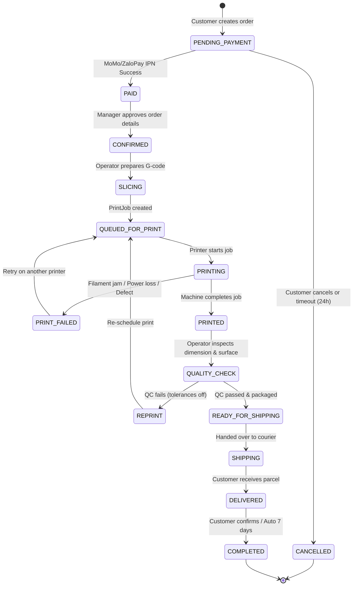

# MEMENTO3D — ORDER LIFECYCLE & BUSINESS FLOW

## 1. Overview
Quy trình đặt in 3D (3D Print Order Flow) là luồng nghiệp vụ trung tâm kết nối giữa sản phẩm tái tạo 3D (Photogrammetry 3D Model Output) và quá trình sản xuất thực tế tại xưởng in.

---

## 2. Order State Machine

---

## 3. Order Processing Steps

### Bước 1: Khởi tạo đơn hàng (Create Order)
- **Actor**: `ROLE_CUSTOMER`
- **Precondition**: Khách hàng đã có một bản dựng 3D hoàn chỉnh (`model_outputs.status == COMPLETED`).
- **Thực thi**: Khách hàng chọn:
  - `modelOutputId`: ID mô hình 3D.
  - `materialId`: Loại vật liệu (ví dụ PLA Trắng, Resin Xám, Silk Gold).
  - `scale`: Tỷ lệ thu phóng (100%, 150%, v.v.).
  - `infillPercentage`: Độ đặc ruột (15%, 20%, 50%, 100%).
  - `finishType`: Xử lý bề mặt (Nguyên bản, Đánh bóng, Sơn màu thủ công).
  - `shippingAddress`: Thông tin địa chỉ nhận hàng.
- **Backend xử lý**:
  - `OrderServiceImpl.createOrder(...)`: Tính toán khối lượng thể tích, lượng vật liệu ước tính ($g$), thời gian in ước tính ($h$), và tổng chi phí.
  - Tạo bản ghi mới trong bảng `orders` với trạng thái `PENDING_PAYMENT`.
  - Sinh mã đơn hàng chuẩn: `ORD-<TIMESTAMP>-<RANDOM>`.

### Bước 2: Thanh toán (Payment)
- **Actor**: `ROLE_CUSTOMER`
- Khách hàng chọn cổng thanh toán MoMo hoặc ZaloPay.
- Hệ thống tạo URL thanh toán và mã QR.
- Sau khi thanh toán thành công qua Webhook IPN, đơn hàng tự động chuyển sang trạng thái `PAID`.

### Bước 3: Xác nhận & Chuẩn bị file in (Confirmation & Slicing)
- **Actor**: `ROLE_OPERATOR` hoặc `ROLE_MANAGER`
- Kỹ thuật viên kiểm tra tính khả thi của mô hình (thành mỏng, góc treo overhang, góc nghiêng cần support).
- Sử dụng phần mềm cắt lớp (Slicer: Cura, PrusaSlicer, OrcaSlicer) để xuất file `.gcode`.
- Tải file G-code lên hệ thống lưu trữ đám mây hoặc trực tiếp vào Memento3D.
- Đơn hàng chuyển sang `CONFIRMED` -> `SLICING` -> `QUEUED_FOR_PRINT`.

### Bước 4: Tạo lệnh in & Gán máy in (Print Job Scheduling)
- Kỹ thuật viên tạo `PrintJob` gắn với máy in 3D có bàn in và đầu đùn tương thích với vật liệu yêu cầu.
- Đơn hàng chuyển sang `PRINTING` khi máy in bắt đầu gia nhiệt đầu phun và bàn nhiệt.

### Bước 5: Giám sát & Hoàn thiện (Monitoring & QC)
- IoT Agent cập nhật tiến độ in (Layer, %, Thời gian còn lại).
- Khi in xong, kỹ thuật viên tiến hành gỡ mẫu, loại bỏ chân chống (support removal), vệ sinh cồn (đối với Resin) hoặc xử lý bề mặt.
- Tiến hành kiểm tra QC:
  - Nếu đạt: Chuyển trạng thái `READY_FOR_SHIPPING`.
  - Nếu hỏng: Đánh dấu `REPRINT`, kích hoạt lệnh in lại trên máy in khác.

### Bước 6: Đóng gói & Giao hàng (Fulfillment)
- Thành phẩm được bọc chống sốc đa lớp, đóng hộp carton kèm thư cảm ơn.
- Bàn giao đơn vị vận chuyển (bưu tá / shipper), đơn hàng chuyển sang `SHIPPING`.
- Khách hàng nhận hàng và nghiệm thu mô hình kỷ niệm, đơn hàng kết thúc ở `COMPLETED`.
