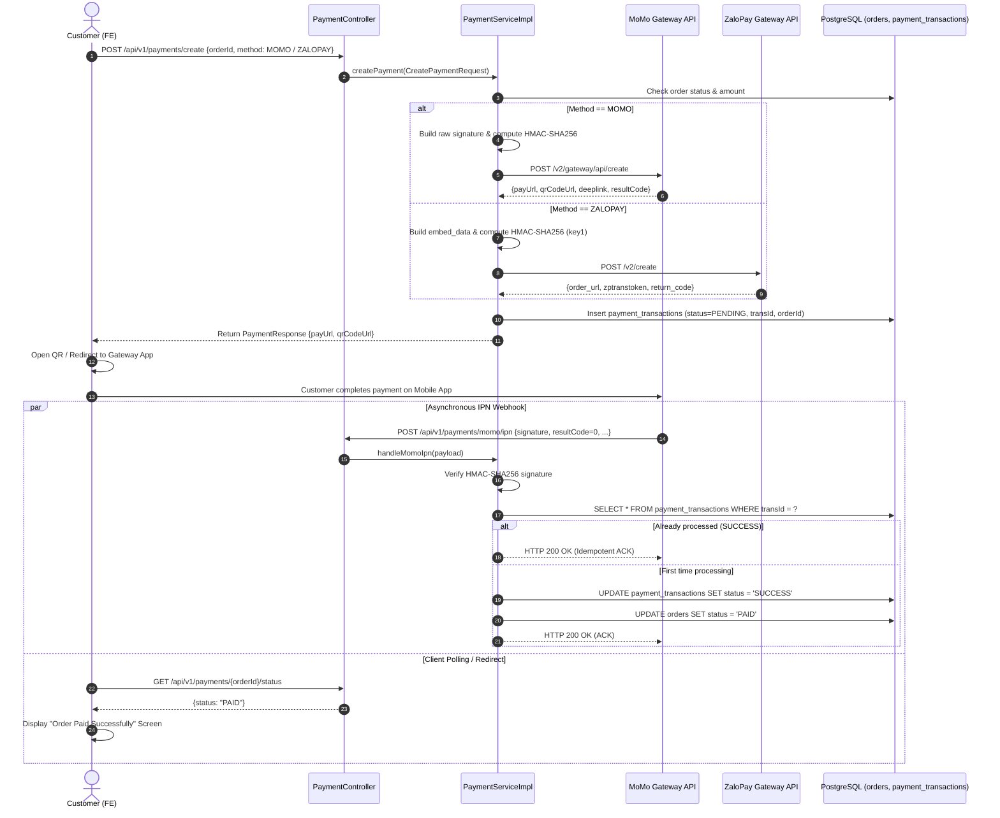

# MEMENTO3D — PAYMENT INTEGRATION & TRANSACTION FLOW

## 1. Overview
Hệ thống thanh toán của Memento3D hỗ trợ hai cổng thanh toán điện tử phổ biến hàng đầu tại Việt Nam:
1. **MoMo Payment Gateway** (QR Code, Deeplink, Web Payment).
2. **ZaloPay Payment Gateway** (QR Code, In-app Sandbox/Production).

Hệ thống được thiết kế theo nguyên tắc:
- **Bảo mật tuyệt đối**: Ký và xác thực chữ ký số HMAC-SHA256 cho toàn bộ payload.
- **Tính bất biến và Idempotent**: Đảm bảo một thông báo Webhook IPN từ cổng thanh toán chỉ kích hoạt cập nhật trạng thái đơn hàng đúng 1 lần duy nhất, tránh việc nạp tiền hoặc ghi nhận trùng lặp.

---

## 2. Payment Architecture & Sequence Diagram



---

## 3. MoMo Integration Details

- **MomoPaymentGateway.java**:
  - `partnerCode`: Mã đối tác do MoMo cấp.
  - `accessKey` & `secretKey`: Cặp khóa xác thực HMAC-SHA256.
  - `endpoint`: `https://test-payment.momo.vn/v2/gateway/api/create` (Sandbox).
  - Định dạng chuỗi ký Request:
    ```text
    accessKey=$accessKey&amount=$amount&extraData=$extraData&ipnUrl=$ipnUrl&orderId=$orderId&orderInfo=$orderInfo&partnerCode=$partnerCode&redirectUrl=$redirectUrl&requestId=$requestId&requestType=captureWallet
    ```
  - Xử lý phản hồi IPN:
    - Khi `resultCode == 0`: Giao dịch thành công.
    - Khác 0: Giao dịch thất bại / Khách hủy giao dịch.

---

## 4. ZaloPay Integration Details

- **ZaloPayPaymentGateway.java**:
  - `appId`: Mã định danh ứng dụng.
  - `key1`: Secret key dùng để sinh chữ ký `mac` khi tạo đơn hàng.
  - `key2`: Secret key dùng để xác thực `mac` trong Webhook callback từ ZaloPay.
  - `endpoint`: `https://sb-openapi.zalopay.vn/v2/create` (Sandbox).
  - Định dạng chuỗi ký Request:
    ```text
    app_id|app_trans_id|app_user|amount|app_time|embed_data|item
    ```
  - Phản hồi IPN Callback:
    - Trả về JSON:
      ```json
      {
        "return_code": 1,
        "return_message": "success"
      }
      ```
    - Nếu chữ ký không khớp:
      ```json
      {
        "return_code": -1,
        "return_message": "mac not equal"
      }
      ```

---

## 5. Security & Idempotency Best Practices

1. **Khóa chống gửi nhiều lần (Concurrency & Locking)**:
   - Dùng pessimistic lock hoặc Unique Constraint trên cặp `(provider, gateway_transaction_id)` để đảm bảo ngay cả khi 2 request IPN đến cùng lúc trong một phần triệu giây, chỉ có 1 request được ghi nhận.
2. **Không tin tưởng Client Redirect URL**:
   - Khách hàng quay trở lại giao diện web thông qua `redirectUrl` chỉ là gợi ý trải nghiệm người dùng. Backend CHỈ chuyển trạng thái đơn hàng sang `PAID` khi nhận được Webhook IPN hợp lệ từ máy chủ của Cổng thanh toán hoặc khi Backend chủ động query kiểm tra trạng thái (`queryPaymentStatus`).
3. **Mã hóa cấu hình**:
   - Toàn bộ secret keys (`MOMO_SECRET_KEY`, `ZALOPAY_KEY1`, `ZALOPAY_KEY2`) phải được nạp thông qua biến môi trường hệ thống, không commit vào kho mã nguồn.
