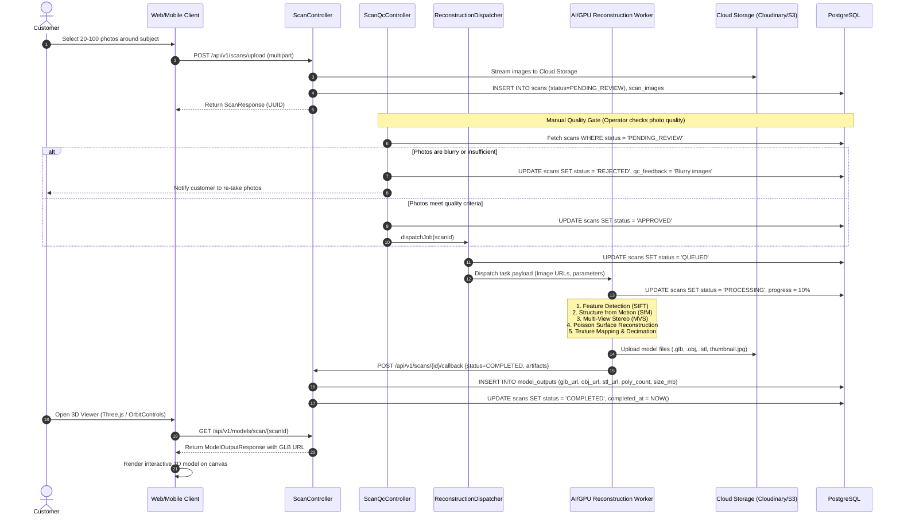
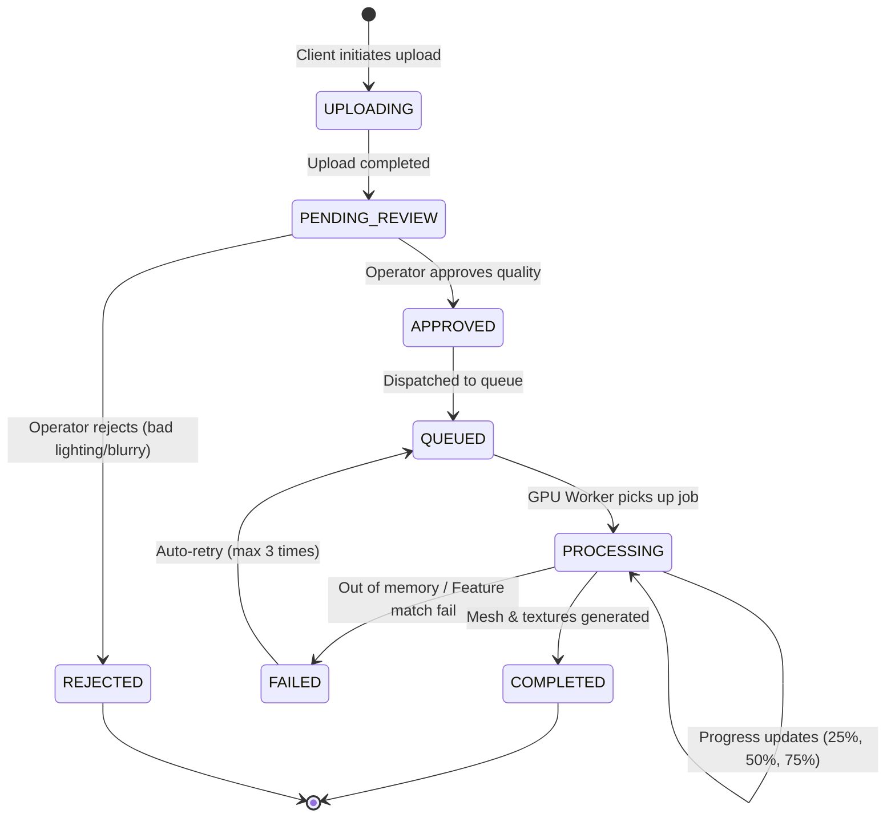

# MEMENTO3D — 3D RECONSTRUCTION & AI WORKER PIPELINE

## 1. Overview
Khối **3D Reconstruction** là trái tim công nghệ của Memento3D, có nhiệm vụ chuyển đổi tập hợp các ảnh chụp 2D đa góc độ của người hoặc vật thể thành mô hình lưới đa giác 3D (3D Polygonal Mesh) kèm vân bề mặt (Texture Map) chân thực với độ chính xác cao.

---

## 2. Photogrammetry & AI Reconstruction Flow

---

## 3. Reconstruction State Machine

---

## 4. Current Implementation Status vs Architecture

### 4.1 Implementation thực tế trong source code
- **Mock Dispatcher (`ReconstructionDispatcherMock.java`)**:
  - Khi môi trường dev hoặc chưa kết nối cụm GPU thật, dispatcher chạy một background executor tự động sinh tiến độ giả lập từ `10% -> 50% -> 100%` trong 15-30 giây.
  - Tự động gắn link mẫu 3D demo chuẩn (`.glb`) vào bảng `model_outputs`.
- **Production Dispatcher (`ReconstructionDispatcherImpl.java`)**:
  - Sử dụng REST API Webhook hoặc Message Queue (RabbitMQ / Redis PubSub) để đẩy job sang GPU Worker bên ngoài chạy Python (sử dụng các thư viện như COLMAP, OpenMVS, hoặc NeRF/Gaussian Splatting to Mesh).

---

## 5. Artifacts Output Structure

Mỗi phiên dựng thành công sẽ tạo ra các file chuẩn:
1. `model.glb`: Định dạng chuẩn tối ưu cho hiển thị Web 3D (Three.js / `<model-viewer>`), nhúng sẵn texture và animation (nếu có).
2. `model.obj` + `model.mtl`: Định dạng chuẩn cho các phần mềm dựng hình 3D (Blender, Maya, 3ds Max).
3. `model.stl`: Định dạng chuẩn không chứa màu sắc, tối ưu riêng cho việc nạp vào phần mềm Slicer in 3D.
4. `thumbnail.webp`: Ảnh chụp góc phối cảnh 3/4 của mô hình để hiển thị danh sách trong Dashboard.
