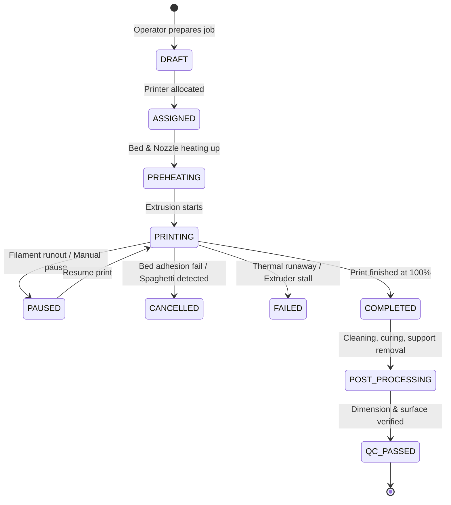
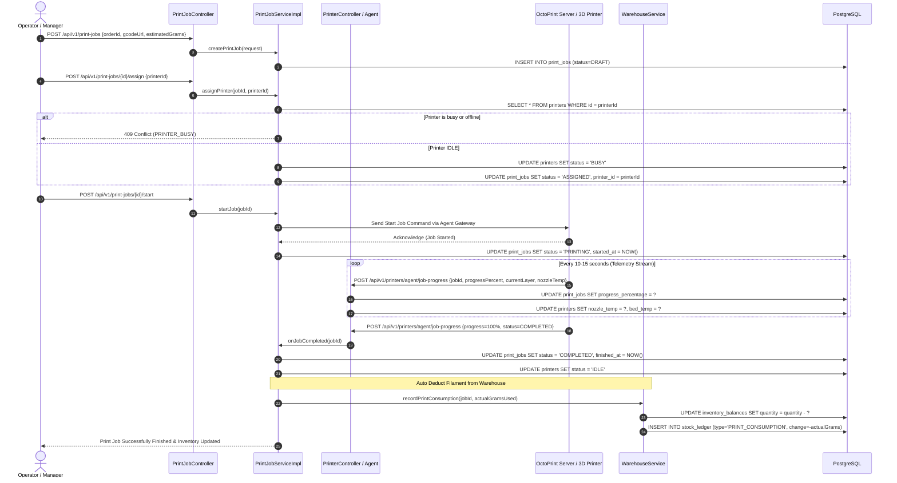

# MEMENTO3D — 3D PRINTING & JOB EXECUTION FLOW

## 1. Overview
Khối **3D Printing Management** điều phối quá trình sản xuất thực tế tại xưởng in 3D: từ việc tiếp nhận file G-code từ đơn hàng, lập lịch lệnh in (`PrintJob`), gán máy in phù hợp, theo dõi thời gian thực, xử lý sự cố đứt sợi/mất điện, cho tới khi hoàn thành và tự động trừ kho vật liệu tiêu hao.

---

## 2. Print Job State Machine

---

## 3. End-to-End Printing Sequence Diagram

---

## 4. Error Handling & Recovery Policies

1. **Cảm biến hết sợi (Filament Runout)**:
   - Khi cảm biến phát hiện hết nhựa, OctoPrint tự động gửi mã trạng thái `PAUSED`.
   - Hệ thống Memento3D gửi notification cho Operator đến nạp cuộn nhựa mới và bấm "Resume".
2. **Lỗi kẹt nhiệt (Thermal Runaway / Extruder Jam)**:
   - Nếu nhiệt độ đầu đùn lệch quá $\pm 5^\circ C$ so với mục tiêu trong hơn 30 giây, firmware máy in sẽ tự động ngắt điện thanh nhiệt để phòng chống cháy nổ.
   - Trạng thái lệnh in chuyển sang `FAILED`, máy in chuyển sang `MAINTENANCE`.
3. **Thất bại bám dính bàn in (Layer Shift / Spaghetti Defect)**:
   - Kỹ thuật viên quan sát qua camera hoặc AI Obico phát hiện mẫu bị bong bàn in.
   - Bấm lệnh `CANCEL`. Vật liệu bị hỏng được ghi nhận vào kho dưới dạng hao hụt phế phẩm (`SCRAP_ISSUE`).
