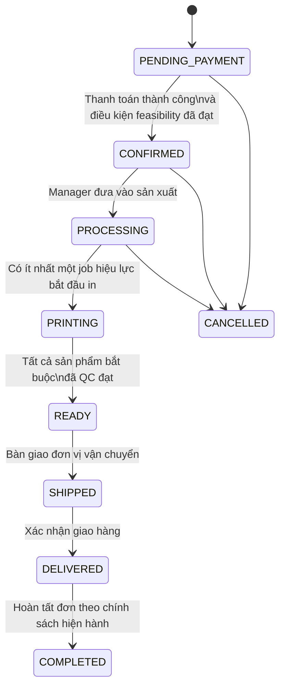
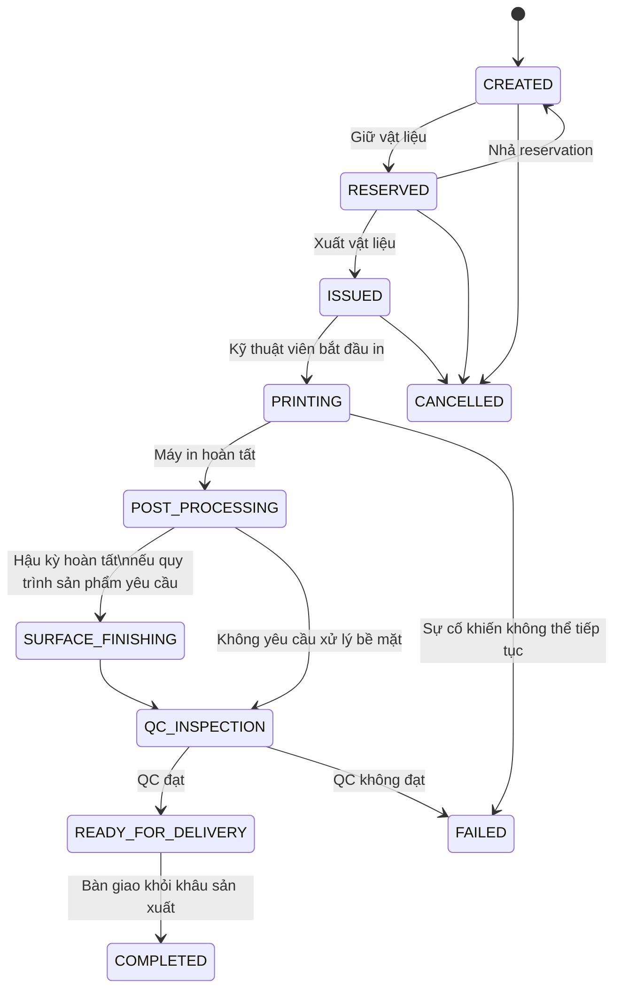

# Đề xuất nghiệp vụ: Đơn hàng và lệnh in

> **Trạng thái:** Bản nghiệp vụ đã thống nhất để làm baseline triển khai và nghiệm thu.
> **Lưu ý:** Đây là trạng thái mục tiêu, không phải mô tả rằng mọi chức năng đã được triển khai. Một số logic hiện tại còn khác và được ghi rõ bên dưới.

## 1. Mục tiêu và nguyên tắc

Tách **quản lý đơn hàng** khỏi **điều hành sản xuất**, nhưng giữ liên kết dữ liệu và đồng bộ tiến độ:

- Đơn hàng theo dõi thanh toán, cam kết với khách hàng và giao nhận.
- Print Job theo dõi sản xuất cho một sản phẩm cụ thể trong đơn.
- Manager xem tiến độ Print Job trong chi tiết đơn nhưng không dùng trang đơn hàng để vận hành vật tư, máy in hoặc QC.
- Backend là nơi thực thi quy tắc nghiệp vụ; không dựa riêng vào việc ẩn/hiện nút ở FE.
- Không coi đối soát vật liệu là bằng chứng đã in xong hoặc QC đạt.
- Không ghi đè lịch sử job lỗi; in lại tạo job mới có quan hệ với job trước.

## 2. Quyết định nghiệp vụ đã thống nhất

| Chủ đề | Quyết định |
|---|---|
| Phạm vi một Print Job | Một job cho mỗi sản phẩm (`orderItem`) |
| Thời điểm tạo job | Đơn đã thanh toán, ở `PROCESSING`; đơn scan phải được chấp thuận và model được duyệt |
| Chống tạo trùng | Tối đa một Print Job còn hiệu lực cho mỗi sản phẩm; reprint là job mới |
| Chuyển đơn sang `PRINTING` | Tự động khi bất kỳ Print Job hiệu lực nào bắt đầu in |
| Chuyển đơn sang `READY` | Tự động khi tất cả sản phẩm bắt buộc có job hiệu lực đã QC đạt và sẵn sàng bàn giao |
| Ý nghĩa `READY_FOR_DELIVERY` | QC đạt, chờ bàn giao sang khâu fulfillment |
| Ý nghĩa `COMPLETED` của Print Job | Đã bàn giao/đóng hồ sơ sản xuất; không chỉ là đã đối soát vật liệu |
| QC không đạt hoặc in lỗi | Job cũ giữ nguyên lịch sử; tạo job reprint mới liên kết với job lỗi |
| Ước tính vật liệu/thời gian | Tạm giữ giá trị hiện tại 250g/4 giờ; chưa coi là giá trị được tính từ model |
| `isOutsource` | Rà soát nghiệp vụ và dọn đồng bộ ở phạm vi riêng; chưa xóa DB/API legacy trong luồng này |

## 3. Vai trò và màn hình

### Manager Orders

- Theo dõi đơn, thanh toán và trạng thái giao hàng.
- Chuyển đơn sang giai đoạn sản xuất khi đủ điều kiện.
- Tạo hoặc xem các Print Job gắn với từng sản phẩm.
- Xem mã job, trạng thái, vật liệu, ước tính và mở màn hình sản xuất.
- Không trực tiếp chuyển trạng thái vật tư/in/QC từ trang đơn hàng.

### Production / Print Jobs

- Kỹ thuật viên hoặc operator xử lý từng Print Job.
- Đặt giữ và xuất vật liệu, bắt đầu in, ghi nhận hậu kỳ và kiểm tra QC.
- Ghi nguyên nhân lỗi; tạo job reprint khi cần.
- Print Job là nguồn dữ liệu tiến độ sản xuất chi tiết.

### Backend

- Kiểm tra các điều kiện tạo job và chuyển trạng thái.
- Bảo đảm quan hệ order-item/job đúng và chống tạo trùng kể cả khi gọi API trực tiếp.
- Đồng bộ trạng thái đơn theo quy tắc trong tài liệu này.
- Giữ lịch sử lỗi/reprint và phát sự kiện phù hợp cho các client.

## 4. Luồng đơn hàng

### Quy tắc chuyển trạng thái đơn

1. `CONFIRMED` sang `PROCESSING` là quyết định đưa đơn vào sản xuất; việc tạo Print Job chỉ hợp lệ sau bước này.
2. `PROCESSING` sang `PRINTING` do hệ thống đồng bộ khi **bất kỳ** job hiệu lực nào bắt đầu in.
3. `PRINTING` sang `READY` chỉ khi:
   - Mỗi sản phẩm bắt buộc của đơn có một job hiệu lực.
   - Job hiệu lực của mọi sản phẩm đã tới `READY_FOR_DELIVERY`, tức đã QC đạt.
   - Không có sản phẩm bị thiếu job, hoặc có job lỗi/hủy chưa được thay thế/xử lý.
4. Manager quản lý giao nhận sau `READY`; không dùng `COMPLETED` của Print Job để suy ra QC đạt.
5. Hủy đơn, hoàn tiền, hủy job sau khi đã xuất vật liệu và các ngoại lệ tài chính cần tuân theo chính sách riêng; không tự suy diễn trong luồng này.

## 5. Luồng Print Job

### Quy tắc job và reprint

- Một job gắn với đúng một `orderItem`, một vật liệu và model version tương ứng nếu sản phẩm có model.
- Trạng thái hậu kỳ/QC phải được ghi nhận rõ; chỉ chuyển `READY_FOR_DELIVERY` sau khi QC đạt.
- `FAILED` không được tính là sản phẩm đã hoàn tất. Job reprint là bản ghi mới, liên kết với job lỗi; không sửa job cũ thành thành công.
- Chỉ job hiệu lực hiện tại của sản phẩm được dùng để xét điều kiện chuyển đơn sang `READY`.
- Job `CANCELLED` không hoàn thành nghĩa vụ sản xuất của sản phẩm. Nếu hủy job mà không có job thay thế, đơn không được tự chuyển `READY`.
- Bỏ qua một bước hậu kỳ chỉ được phép khi quy trình của sản phẩm xác định bước đó không áp dụng; không cho phép nhảy trạng thái tùy ý.

## 6. Điều kiện backend bắt buộc khi tạo Print Job

Backend phải xác thực trong cùng luồng xử lý tạo job:

1. Order tồn tại và đang ở `PROCESSING`.
2. Trạng thái thanh toán là đã thanh toán.
3. Với order scan: feasibility đã được chấp thuận và model version được gắn với job đã được duyệt.
4. `orderItemId` tồn tại và thuộc chính `orderId` được gửi lên.
5. Chưa có job hiệu lực khác cho sản phẩm đó.
6. Material tồn tại và active; các estimate thỏa validation hiện hành.
7. Không tin cậy `orderId`, `orderItemId`, điều kiện thanh toán hoặc trạng thái do client tự khai báo nếu backend có thể truy xuất dữ liệu nguồn.

FE cần gửi `orderItemId`. Backend cần chống trùng khi có hai request đồng thời, không chỉ dựa vào nút bị disable ở UI.

## 7. Yêu cầu UI/UX

### Modal tạo job

- Manager chọn sản phẩm/order item cần tạo job; không tạo một job đại diện cho cả đơn nhiều sản phẩm.
- Hiển thị rõ sản phẩm được chọn để tránh gắn nhầm job.
- Giữ estimate 250g và 14.400 giây trong giai đoạn hiện tại theo quyết định đã thống nhất; trình bày đây là **ước tính tạm thời**, không khẳng định được tính từ model.
- Không đưa tùy chọn outsourcing vào luồng này cho đến khi nghiệp vụ được chốt.

### Chi tiết đơn hàng

- Hiển thị danh sách job theo từng order item: mã job, trạng thái, vật liệu, khối lượng/thời gian ước tính và link sang trang Print Jobs.
- Có loading, lỗi tải danh sách và trạng thái chưa có job rõ ràng.
- Không tải một trang job giới hạn rồi lọc tại trình duyệt; API cần hỗ trợ truy vấn theo `orderId`/sản phẩm.
- Nút chuyển trạng thái đơn phản ánh điều kiện do backend áp dụng và không được xem `COMPLETED` là “đang in” hoặc “QC đạt”.

### Màn hình Print Jobs

- Là nơi duy nhất thao tác reservation, xuất vật liệu, in, hậu kỳ, QC và reprint.
- Chỉ hiển thị thao tác hợp lệ với trạng thái hiện tại; backend vẫn phải xác thực lại.
- Hiển thị quan hệ về order/order item để kỹ thuật truy vết được sản phẩm.

## 8. Hiện trạng code cần lưu ý trước khi triển khai

Các điểm sau là khoảng cách giữa code hiện tại và flow mục tiêu:

- FE modal tạo job hiện chỉ gửi `orderId`, chưa gửi `orderItemId`.
- FE trang đơn đang tải tối đa 50 Print Job rồi lọc theo `orderId`; API list cần bộ lọc theo order.
- Backend hiện chỉ kiểm tra job trùng theo `orderItemId` khi trường này được gửi; chưa kiểm tra đầy đủ điều kiện thanh toán và trạng thái `PROCESSING`.
- Backend hiện chuyển job sang `COMPLETED` sau đối soát vật liệu trong một số trạng thái; thao tác đó không chứng minh QC đạt.
- FE hiện dùng `PRINTING` **hoặc `COMPLETED`** làm dấu hiệu có job đang chạy. `COMPLETED` không nên được coi là đang in.
- Enum backend có các trạng thái như `POST_PROCESSING`, `QC_INSPECTION`, `READY_FOR_DELIVERY`, nhưng luồng API hiện tại chưa thực thi đầy đủ các chuyển trạng thái này.
- Route tạo job theo order cần được chuẩn hóa; controller hiện khai báo route con có lặp tiền tố `/api/v1`.
- Các tài liệu order/printing cũ có state machine và tích hợp printer/G-code không khớp hoàn toàn với API hiện tại. Không xem các phần tích hợp đó là chức năng đã tồn tại nếu chưa được xác minh.

## 9. Giai đoạn triển khai đề xuất

### Giai đoạn 0 — Baseline nghiệp vụ

- Tài liệu này là đối chiếu cho phạm vi và tiêu chí nghiệm thu.
- Không thay đổi code trong giai đoạn chốt nghiệp vụ.

### Giai đoạn 1 — Quan hệ job và UI theo sản phẩm

- Tạo một job cho từng order item.
- Backend validation, kiểm tra sở hữu item và chống trùng.
- API truy vấn job theo order.
- Hiển thị job trong chi tiết đơn và bỏ các điều kiện FE sai lệch.
- Giữ estimate tạm thời; chưa xóa dữ liệu legacy `isOutsource`.
- Chưa tuyên bố đã có workflow hậu kỳ/QC nếu các bước đó chưa được triển khai.

### Giai đoạn 2 — Vòng đời sản xuất và QC

- Triển khai chuyển trạng thái hợp lệ, ghi nhận hậu kỳ/QC pass/fail.
- Định nghĩa sự kiện/người chịu trách nhiệm cho từng bước.
- Tạo reprint job liên kết với job lỗi và giữ lịch sử.

### Giai đoạn 3 — Đồng bộ Order và fulfillment

- Tự đồng bộ `PRINTING` khi có job bắt đầu in.
- Tự đồng bộ `READY` chỉ khi tất cả sản phẩm bắt buộc QC đạt.
- Đồng bộ giao nhận và xử lý ngoại lệ/đơn nhiều sản phẩm.
- Bổ sung kiểm thử tích hợp cho các đường đi thành công, lỗi, reprint và race condition.

## 10. Tiêu chí nghiệm thu

### Tạo job

- Đơn chưa thanh toán, không ở `PROCESSING`, hoặc scan chưa đủ điều kiện thì backend từ chối tạo job.
- Không thể gắn `orderItemId` của đơn khác.
- Request tạo trùng cho cùng sản phẩm bị từ chối kể cả khi gọi trực tiếp API hoặc gửi đồng thời.
- Đơn nhiều sản phẩm tạo được một job riêng cho từng sản phẩm; job trả về hiển thị đúng sản phẩm.

### Theo dõi và trạng thái

- Trang đơn tải và hiển thị toàn bộ job thuộc đơn qua API có lọc, không phụ thuộc giới hạn 50 bản ghi đầu.
- `PRINTING` chỉ xuất hiện khi có job thực sự bắt đầu in.
- Đối soát vật liệu không làm job được hiểu là QC đạt.
- Một sản phẩm thiếu job, job lỗi/hủy chưa thay thế, hoặc còn QC chưa đạt sẽ chặn `READY`.
- Chỉ khi mọi sản phẩm bắt buộc có job hiệu lực QC đạt, đơn mới chuyển `READY`.
- Reprint tạo job mới, giữ job lỗi và truy vết được quan hệ giữa hai job.

### Phân tách UI

- Manager xử lý trạng thái đơn/giao nhận ở trang đơn; kỹ thuật xử lý quy trình sản xuất ở trang Print Jobs.
- Trang đơn vẫn cho Manager biết tiến độ từng sản phẩm và mở đúng Print Job.
- FE không thay thế validation của backend.
