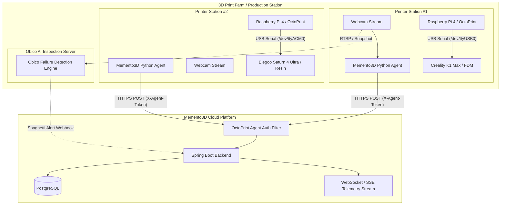

# MEMENTO3D — 3D PRINTER INTEGRATION & OCTOPRINT AGENT GUIDE

## 1. Overview
Để điều khiển và giám sát hàng chục máy in 3D phân tán tại các trạm sản xuất, Memento3D sử dụng kiến trúc **IoT Agent Gateway**. Mỗi máy in 3D được kết nối vật lý qua cổng USB Serial với một bo mạch điều khiển (Raspberry Pi hoặc Thin Client mini PC) cài đặt **OctoPrint** và **Memento3D Python Daemon Agent**.

---

## 2. IoT Network & Gateway Architecture



---

## 3. Communication Protocols & Authentication

### 3.1 Authentication Mechanism
Mỗi máy in khi được khai báo trong hệ thống sẽ được cấp một mã bí mật duy nhất: `agent_token` (định dạng UUIDv4 ngẫu nhiên hoặc token 256-bit).
Mọi request từ Agent gửi lên Backend bắt buộc phải đính kèm HTTP Header:
```http
X-Agent-Token: memento_agent_9b1deb4d3b7d4bad9bdd2b0d7b3dcb6d
```

### 3.2 Heartbeat Protocol
- **Chu kỳ**: Gửi định kỳ mỗi **15 giây**.
- **Endpoint**: `POST /api/v1/printers/agent/heartbeat`
- **Payload**:
  ```json
  {
    "printerId": "d3b07384-d113-4f44-9f82-a3a830b561c2",
    "timestamp": 1776510000000,
    "firmwareVersion": "Marlin 2.1.2",
    "ipAddress": "192.168.1.150"
  }
  ```

### 3.3 Telemetry Protocol
- **Chu kỳ**: Gửi định kỳ mỗi **5 - 10 giây** khi máy đang in.
- **Endpoint**: `POST /api/v1/printers/agent/telemetry`
- **Payload**:
  ```json
  {
    "printerId": "d3b07384-d113-4f44-9f82-a3a830b561c2",
    "nozzleTempActual": 210.4,
    "nozzleTempTarget": 210.0,
    "bedTempActual": 60.1,
    "bedTempTarget": 60.0,
    "chamberTempActual": 35.0,
    "fanSpeedPercent": 100,
    "printSpeedPercent": 100
  }
  ```

### 3.4 Job Progress Protocol
- **Endpoint**: `POST /api/v1/printers/agent/job-progress`
- **Payload**:
  ```json
  {
    "printerId": "d3b07384-d113-4f44-9f82-a3a830b561c2",
    "jobId": "8f8b0432-8411-4475-bcf9-42b47b4d13fa",
    "status": "PRINTING",
    "progressPercentage": 45.8,
    "currentLayer": 245,
    "totalLayers": 535,
    "printTimeSeconds": 3600,
    "printTimeRemainingSeconds": 4200
  }
  ```

---

## 4. Obico Integration (AI Failure Detection)
- **Mục đích**: Tự động phát hiện lỗi bung mẫu, tạo "mì spaghetti" (Spaghetti failure) qua webcam máy tính trong vòng 3 phút đầu khi xảy ra lỗi.
- **Hành vi**:
  - Khi tỷ lệ tin cậy của Obico vượt quá `80%`:
  - Obico gửi webhook cảnh báo tới `/api/v1/printers/agent/alert`.
  - Backend lập tức gửi lệnh tạm dừng (`PAUSE`) tới OctoPrint để bảo vệ đầu đùn, đồng thời gửi thông báo khẩn qua Telegram / Notification tới Operator.
