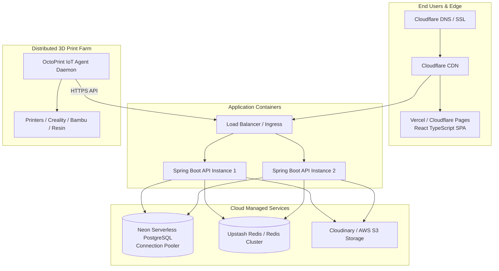

# MEMENTO3D — DEPLOYMENT & INFRASTRUCTURE GUIDE

## 1. Production Architecture Overview



---

## 2. Docker & Containerization

### 2.1 Backend Dockerfile (`Memento3D-Backend/memeto3D/Dockerfile`)
```dockerfile
# Multi-stage Build for Java 21 Spring Boot
FROM maven:3.9.6-eclipse-temurin-21-alpine AS builder
WORKDIR /app
COPY pom.xml .
RUN mvn dependency:go-offline -B
COPY src ./src
RUN mvn clean package -DskipTests -B

# Runtime Image
FROM eclipse-temurin:21-jre-alpine
WORKDIR /app
RUN addgroup -S appgroup && adduser -S appuser -G appgroup
USER appuser
COPY --from=builder /app/target/*.jar app.jar
EXPOSE 8080
ENV JAVA_OPTS="-XX:+UseG1GC -XX:MaxRAMPercentage=75.0"
ENTRYPOINT ["sh", "-c", "java $JAVA_OPTS -jar app.jar"]
```

### 2.2 Frontend Dockerfile (`Memento3D-Fronted-Web/Dockerfile`)
```dockerfile
# Build Stage
FROM node:20-alpine AS build
WORKDIR /app
COPY package*.json ./
RUN npm ci
COPY . .
RUN npm run build

# Nginx Production Stage
FROM nginx:alpine
COPY --from=build /app/dist /usr/share/nginx/html
COPY nginx.conf /etc/nginx/conf.d/default.conf
EXPOSE 80
CMD ["nginx", "-g", "daemon off;"]
```

### 2.3 Frontend `nginx.conf` (SPA Routing)
```nginx
server {
    listen 80;
    server_name localhost;
    root /usr/share/nginx/html;
    index index.html;

    location / {
        try_files $uri $uri/ /index.html;
    }

    location /api/ {
        proxy_pass http://backend:8080;
        proxy_set_header Host $host;
        proxy_set_header X-Real-IP $remote_addr;
        proxy_set_header X-Forwarded-For $proxy_add_x_forwarded_for;
        proxy_set_header X-Forwarded-Proto $scheme;
    }
}
```

---

## 3. Cloud Provider Deployments

### 3.1 Neon PostgreSQL Setup
- Khởi tạo project trên Neon Console.
- Lựa chọn Connection String dạng Pooled:
  ```text
  jdbc:postgresql://ep-silent-shadow-a1b2c3d4-pooler.ap-southeast-1.aws.neon.tech/memento3d?sslmode=require
  ```
- Neon tự động scale-to-zero khi không có traffic giúp tối ưu chi phí hạ tầng.

### 3.2 Vercel Frontend Deployment
- Kết nối GitHub Repository `Memento3d`.
- Chọn thư mục gốc (Root Directory): `Memento3D-Fronted-Web`.
- Build Command: `npm run build`.
- Output Directory: `dist`.
- Biến môi trường:
  - `VITE_API_BASE_URL`: `https://api.memento3d.vn/api/v1`
  - `VITE_GOOGLE_CLIENT_ID`: `<Google OAuth Client ID>`
- Thêm file `vercel.json` để chuyển hướng URL:
  ```json
  {
    "rewrites": [
      { "source": "/(.*)", "destination": "/index.html" }
    ]
  }
  ```
