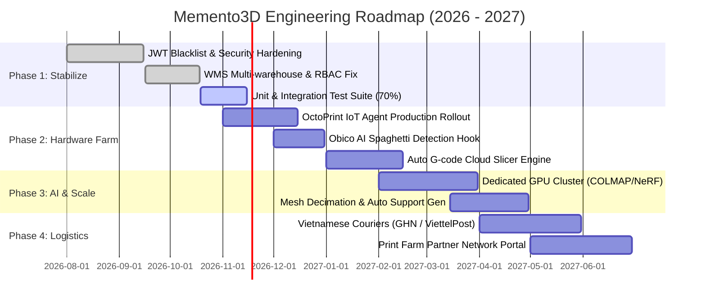

# MEMENTO3D — PRODUCT ROADMAP & DEFINITION OF DONE

## 1. Development Phases & Roadmap

---

## 2. Detailed Phase Breakdown

### Phase 1 — Stabilize & Solidify (Hiện tại — Q4/2026)
- **Mục tiêu**: Đảm bảo toàn bộ luồng nghiệp vụ hiện tại hoạt động trơn tru không lỗi, xử lý triệt để các vấn đề bảo mật và phân quyền.
- **Key Tasks**:
  - [x] Sửa lỗi phân quyền Kho cho Operator & Manager (`WarehouseSecurityService`).
  - [x] Tạo bộ tài liệu hoàn chỉnh `MEMENTO3D_DEVELOPER_GUIDE.md` và Developer Docs.
  - [ ] Bổ sung Unit Test cho luồng tính toán giá đơn hàng và trừ kho tự động.
  - [ ] Cấu hình rate limit bằng Redis Bucket4j trên các endpoint upload ảnh và login.

### Phase 2 — Production Hardware & IoT (Q4/2026 — Q1/2027)
- **Mục tiêu**: Kết nối thực tế với trang trại 20+ máy in 3D FDM & SLA thông qua bo mạch Raspberry Pi OctoPrint.
- **Key Tasks**:
  - [ ] Đóng gói Memento3D Python Agent thành file cài đặt `.deb` hoặc Docker image cho Raspberry Pi.
  - [ ] Hoàn thiện kết nối Webhook với Obico server để tự động dừng in khi phát hiện lỗi tưa sợi.
  - [ ] Tích hợp công cụ cắt lớp tự động trên Cloud (CuraEngine CLI / PrusaSlicer CLI) để biến file 3D STL thành file G-code mà không cần Operator can thiệp thủ công.

### Phase 3 — High-Performance AI Photogrammetry (Q1/2027 — Q2/2027)
- **Mục tiêu**: Rút ngắn thời gian tạo mô hình 3D từ 15 phút xuống dưới 3 phút với chất lượng siêu nét.
- **Key Tasks**:
  - [ ] Triển khai cụm worker GPU (NVIDIA A100 / RTX 4090) chạy mô hình 3D Gaussian Splatting và NeRF.
  - [ ] Xây dựng thuật toán tự động làm kín lỗ hổng (Watertight manifold meshing) để file 3D luôn luôn in được mà không bị rỗng bề mặt.

### Phase 4 — Logistics & Partner Ecosystem (Q2/2027)
- **Mục tiêu**: Tự động hóa khâu giao vận và mở rộng mạng lưới xưởng in gia công vệ tinh.
- **Key Tasks**:
  - [ ] Tích hợp API tạo vận đơn và in mã vận đơn tự động với Giao Hàng Nhanh (GHN) và Viettel Post.
  - [ ] Hoàn thiện Provider Portal cho phép các xưởng in ngoài nhận gia công đơn hàng khi xưởng chính quá tải.

---

## 3. Definition of Done (DoD)

Một User Story hoặc Feature chỉ được coi là **DONE** và sẵn sàng merge vào nhánh `main` khi đáp ứng đủ 10 tiêu chí:

1. [ ] **Database Design**: Bảng được thiết kế chuẩn hóa 3NF, có đầy đủ Foreign Keys, Unique Constraints, và Migration script (Flyway).
2. [ ] **Security**: Kiểm tra quyền truy cập chặt chẽ (`@PreAuthorize`), bảo vệ phân quyền dữ liệu cá nhân (Ownership guard), không rò rỉ dữ liệu.
3. [ ] **Service Logic**: Viết trong Service có `@Transactional`, không để logic nghiệp vụ rò rỉ ra ngoài Controller.
4. [ ] **Data Mapping**: 100% sử dụng MapStruct, không trả Entity trực tiếp ra API.
5. [ ] **Validation**: Có Jakarta Validation (`@NotNull`, `@NotBlank`, `@Min`, v.v.) trên mọi Request DTO.
6. [ ] **Audit Trail**: Ghi nhận thời gian tạo/sửa (`createdAt`, `updatedAt`, `createdBy`).
7. [ ] **OpenAPI / Swagger**: Đầy đủ annotations `@Operation`, `@ApiResponse`, hiển thị chuẩn trên Swagger UI.
8. [ ] **Frontend Integration**: Tích hợp màn hình hoàn chỉnh, có Loading state, Empty state, và Toast thông báo lỗi rõ ràng.
9. [ ] **Testing**: Đạt tối thiểu 70% Unit Test coverage cho phần Service mới viết.
10. [ ] **Documentation**: Cập nhật thông tin endpoint vào `docs/04-api-reference.md`.
