# Đề xuất tích hợp custom model 3D cho web, app, BE và AI

Ngày: 2026-11-05. Trạng thái: **đề xuất để chốt phạm vi**, chưa triển khai API/UI trong tài liệu này. Output mặt/cổ hiện tại được giữ làm baseline thị giác cho vòng tích hợp; không tiếp tục thay hình dạng mặt trong phạm vi này.

## 1. Trải nghiệm MVP đề xuất

Sau khi tạo model xong, khách mở khu vực **Tùy chỉnh** ngay cạnh viewer:

```text
┌───────────────────────────────┬─────────────────────────────┐
│                               │ Kiểu đầu                    │
│       Viewer 3D hiện tại       │ [ Mũ tốt nghiệp ] [ Tóc ]  │
│                               │                             │
│   Xoay / phóng / xem gần mặt   │ Kiểu tóc (khi chọn Tóc)     │
│                               │ [ảnh mẫu 1] [ảnh mẫu 2]    │
│                               │                             │
│                               │ Mắt kính                    │
│                               │ [Không kính] [ảnh 1] [ảnh 2]│
├───────────────────────────────┴─────────────────────────────┤
│ [Khôi phục]  [Lưu thiết kế]  [Chuẩn bị bản đặt sản xuất]   │
└─────────────────────────────────────────────────────────────┘
```

- Danh sách dùng **ảnh thumbnail và tên mẫu**; chỉ một canvas 3D lớn. Không dựng một canvas cho mỗi asset.
- Mũ và tóc loại trừ nhau; kính là lựa chọn độc lập, có thể tháo.
- Chọn mẫu cập nhật preview ngay từ dữ liệu fit đã chuẩn bị. Không chạy lại tái tạo đầu AI mỗi lần click.
- Cấu hình mặc định do BE trả về, đúng output/preset đã duyệt cho model đó.
- Mobile dùng panel dưới viewer hoặc bottom sheet; dùng cùng hợp đồng dữ liệu với web.
- MVP chỉ mở vài mẫu đã kiểm tra: khoảng hai kính và một đến hai tóc. 29 kính đã tải là thư viện ứng viên, chưa phải 29 lựa chọn đã hỗ trợ.
- Có loading riêng cho phụ kiện, báo lỗi tải, khôi phục lựa chọn trước nếu tải lỗi, trạng thái chưa lưu và nút khôi phục bản đã lưu.

## 2. Hiện trạng code đã rà soát

### FE

- `src/features/reconstruction/components/Keepsake3DViewer.tsx` nhận một `modelUrl`, load một GLB và khởi tạo lại scene khi URL đổi.
- Viewer tự căn giữa và đặt đáy model lên mặt bàn. Nếu áp dụng riêng thao tác này cho từng phụ kiện thì kính/tóc sẽ lệch mặt.
- Cleanup hiện dispose geometry/material nhưng chưa quản lý đầy đủ texture và tài nguyên dùng chung trong cache asset.
- `OrderKeepsakeModal.tsx` tự tạo `customizationSnapshot`, có `modelUrl` và ước tính giá phía client.
- `scanReconstructionService.ts` đã có output ID, attempt ID, SHA và delivery URL; cần thêm hợp đồng scene/customization, không bỏ luồng output cũ.

### BE

- Đã có `GET /api/v1/customization-options` và API admin. `CustomizationOption` phục vụ tùy chọn nghiệp vụ, giá, material/base/engraving/accessories; chưa có đầy đủ file GLB, thumbnail, phiên bản và dữ liệu fit theo khuôn mặt.
- Đã có `modelreview.ModelVersion`, trạng thái `MODEL_READY`, `APPROVED`, `LOCKED` và API duyệt/yêu cầu sửa. Tái sử dụng vòng đời này, không tạo một hệ model version cạnh tranh.
- API hiện tại `GET /api/v1/models/{modelId}` lấy **model output**, trong khi `/api/v1/models/{scanId}/versions` dùng **scan ID**. Endpoint mới dùng tên `model-versions` để phân biệt rõ các loại ID.
- `CreateOrderRequest` hiện chưa có `customizationSnapshot` mà FE gửi; nhánh scan trong `OrderServiceImpl` vẫn tạo snapshot vật liệu/kích thước/đế cố định và quantity 1. Chỉ sửa FE sẽ không lưu đúng lựa chọn.
- `PrintJob` có `modelVersionId`, nhưng `ResinProductionServiceImpl.prepare` hiện gán `orderItem.getId()` làm model version ID và lấy GLB đầu tiên theo order item. Cần thay bằng version thực sự đã chốt.
- `DigitalAsset` là file đầu ra thuộc user/job, có `userId` bắt buộc. Không dùng trực tiếp nó làm toàn bộ catalog phụ kiện dùng chung.

## 3. Điều kiện đóng gói trước khi nối API

Output được giữ nguyên về mặt thị giác nhưng phải có cấu trúc phục vụ custom:

- Baseline/preset hiển thị phải có bản **không gắn kính**, tránh thêm kính mới đè lên kính có sẵn trong composite.
- Phân biệt body, personalized head, headwear và glasses bằng ID/node ổn định hoặc file riêng.
- Bản mũ và bản tóc hiện dùng preset body/bàn tay khác nhau. Mask mũ vẫn lẫn phần tay tại vùng chạm. Vì vậy MVP nên khai báo rõ hai **assembly preset đã duyệt**; khi chuyển mũ/tóc có thể chuyển scene nền tương ứng, rồi gắn kính đã fit cho preset đó. Chưa coi đây là hai mesh có thể tùy ý bật/tắt trên cùng một body.
- UI cần hiển thị đúng thumbnail của toàn preset nếu pose cũng thay đổi. Về sau chuẩn hóa body/tách mũ sạch mới chuyển sang đổi riêng mesh headwear.
- File được đóng gói từ **đầu của từng job/người dùng** theo policy đã chốt. Không lấy đầu của bản thử hiện tại gắn cho các ảnh mới.
- Job chưa có đủ preset/fit thì BE chỉ công bố các lựa chọn thật sự có sẵn; giữ viewer GLB cũ cho model legacy.

## 4. Phân chia trách nhiệm

| Thành phần | Trách nhiệm |
| --- | --- |
| AI/Python | Tạo đầu của job, đóng gói preset, tính fit theo mắt/mũi/tai/đầu, xuất placement và composite từ cấu hình chốt |
| BE | Catalog/version, quyền sở hữu, validation, snapshot cấu hình, job export, B2, duyệt version và liên kết đơn/in |
| FE/web/app | Chọn thumbnail, tải scene/asset, áp transform đã được server tính, preview và lưu lựa chọn |
| B2 | GLB asset/preset, preview, master và manifest theo key/version ổn định |

FE không tự quyết định transform được dùng để in. BE không tin matrix, giá hoặc URL do client tùy ý gửi. Chọn asset không yêu cầu chạy lại mạng tái tạo đầu; fit/export là tác vụ lắp ghép riêng.

## 5. API đề xuất cho MVP

Tất cả route dưới đây có tiền tố `/api/v1`. Đây là route mới đề xuất, không phải API đã tồn tại.

| Method và route | Mục đích |
| --- | --- |
| `GET /customization-assets?kind=GLASSES&cursor=...` | Catalog active: ID/version, tên, thumbnail, loại, thông tin preset; không tải mọi GLB |
| `GET /model-versions/{versionId}/scene` | Scene của model cụ thể: preset có sẵn, mặc định, asset tương thích, placement đã fit, URL ký và hạn dùng |
| `POST /model-versions/{versionId}/customizations` | Lưu một cấu hình bất biến; BE kiểm tra quyền, preset, asset version và fit |
| `GET /model-customizations/{customizationId}` | Mở lại thiết kế đã lưu, trả manifest chuẩn và URL mới nếu cần |
| `POST /model-customizations/{customizationId}/exports` | Tạo job ghép/xuất cấu hình đã chốt; trả `202` và export job ID |
| `GET /customization-exports/{exportId}` | Trạng thái export, lỗi, artifact và final `modelVersionId` khi thành công |

Catalog chung có thể cache; scene theo model là nguồn quyết định lựa chọn nào được bật. MVP có thể trả đầy đủ metadata của vài asset tương thích ngay trong scene để FE không cần gọi catalog hai lần.

Không cần API preview riêng cho mỗi lần click khi các fit đã được chuẩn bị. Nếu bổ sung asset chưa fit, worker phải tạo fit trước và scene chỉ bật lựa chọn khi `fitStatus=READY`; FE không giả vờ đã fit.

### API hiện có cần mở rộng/tái sử dụng

- `POST /orders`: bổ sung **final `modelVersionId`** và hợp đồng tùy chọn sản xuất/quote rõ ràng. BE truy ra customization tương ứng và tự sinh snapshot; không dùng `modelUrl` hoặc JSON tự khai từ FE làm nguồn sự thật.
- API trả chi tiết order item: thêm final version, thông tin lựa chọn đã chốt, ảnh/bản preview và các trạng thái export/review cần thiết.
- Tái sử dụng `GET /models/{scanId}/versions`, `POST /models/versions/{versionId}/approve` và `request-revision`. Duyệt bản gốc không đồng nghĩa duyệt mọi bản custom sinh sau đó.
- Tái sử dụng SSE/outbox cho export nếu phù hợp; FE vẫn có polling trạng thái làm đường dự phòng. Không dùng progress giả hoặc phát sự kiện hoàn thành trước khi file được lưu thành công.

### Quản trị asset

Giai đoạn đầu seed/import vài asset đã kiểm tra; chưa cần làm trang upload hoàn chỉnh. Sau đó bổ sung `GET/POST /admin/customization-assets`, cập nhật active và tạo **phiên bản mới** khi đổi file/profile. Có thể liên kết tới `CustomizationOption` để tái sử dụng giá và yêu cầu review hiện có.

Không ghi đè file của asset version đang được đơn/Print Job tham chiếu. Tắt asset chỉ chặn lựa chọn mới; lịch sử đã chốt vẫn giữ ID/hash nguồn.

## 6. Hợp đồng dữ liệu tối thiểu

Ví dụ phần cấu hình client gửi khi lưu (ID dưới đây chỉ minh họa):

```json
{
  "presetVersionId": "graduation-cap-preset-v1",
  "headwear": "CAP",
  "hairAssetVersionId": null,
  "glassesAssetVersionId": "round-glasses-v1",
  "parentCustomizationId": null
}
```

Model version gốc nằm trong route; BE xác thực tất cả ID thuộc bộ lựa chọn tương thích của version đó. Mũ và tóc không thể cùng active. Kính `null` nghĩa là không kính. Khi dùng preset tóc, hair ID phải khớp preset/fit đã công bố; không nhận asset bất kỳ chưa fit.

Scene/manifest chuẩn cần có:

- `schemaVersion`, `baseModelVersionId`, nguồn output/attempt và SHA, `templateVersion`, `fitPolicyVersion`.
- `assemblyPresets`: preset ID/version, base GLB không kính, headwear mặc định, pose metadata và lựa chọn được phép.
- Asset ID/version, loại, thumbnail, file reference, SHA, kích thước file, phạm vi tương thích.
- Placement ID/version ràng buộc với model + preset + asset; `fitStatus`, transform và cảnh báo fit.
- Hệ tọa độ **glTF Y-up, mét**; quy ước matrix column-major phải thống nhất và được test bằng fixture. Fit được gắn với đúng preset/anchor, không dùng một offset cho tất cả ảnh.
- URL tải ký có `expiresAt`; DB/snapshot dùng storage key và ID/hash ổn định. Không lưu signed URL hết hạn làm nguồn model của đơn.

Khi lưu, BE sinh canonical configuration và `configurationHash`, gồm version của asset/profile/placement. Sửa lựa chọn tạo cấu hình mới. Không thay snapshot của đơn cũ bằng thiết kế mới nhất của người dùng.

## 7. Dữ liệu BE và vòng đời version

Đề xuất thêm các nhóm dữ liệu sau, tên bảng cụ thể chốt theo migration:

| Dữ liệu | Nội dung |
| --- | --- |
| `customization_assets` / asset versions | Loại, tên, thumbnail, B2 key, SHA, profile version, active, license/provenance, liên kết option nghiệp vụ nếu có |
| `model_asset_fits` | Base version + preset version + asset version, placement/matrix, trạng thái/diagnostics và policy |
| `model_customizations` | Owner, base version, lựa chọn canonical, configuration hash và liên kết export/final version |
| Export job/artifact | Customization ID, trạng thái, idempotency, nguồn pinned, preview/master asset references, lỗi |

`ModelVersion` hiện có được mở rộng để liên kết customization, output/artifact ID, preview/master storage references và content hash. Nội dung version đã xuất/chốt là bất biến; trạng thái review vẫn đi theo workflow hiện có. Tránh tạo version với URL giả khi export chưa xong vì `modelUrl` hiện bắt buộc.

Luồng đề xuất:

```mermaid
flowchart LR
    A[Đầu AI và model gốc] --> B[Scene và các fit đã chuẩn bị]
    B --> C[Khách chọn preset và kính trên FE]
    C --> D[Lưu customization canonical]
    D --> E[Job export preview và master]
    E --> F[ModelVersion mới có artifact thật]
    F --> G[Khách xem và duyệt đúng version]
    G --> H[OrderItem giữ modelVersionId và snapshot]
    H --> I[Feasibility và các điều kiện sản xuất]
    I --> J[Print Job dùng đúng version đã chốt]
```



Tạo version number phải chống race theo scan. Export có idempotency theo cấu hình canonical + source/policy versions; click hai lần không tạo hai tác vụ nặng hoặc hai version hoàn thành tương đương ngoài ý muốn.

## 8. FE render và quản lý trạng thái

Mở rộng viewer hiện có bằng một lớp quản lý scene, giữ renderer/camera tồn tại khi chọn phụ kiện:

```text
ModelRoot (căn vị trí hiển thị một lần)
├── BaseAssemblyGroup (body + personalized head + headwear preset)
└── GlassesGroup (placement trong cùng hệ tọa độ model)
```

- Bản về sau tách headwear sạch có thể thêm `HeadwearGroup`; MVP giữ preset đồng bộ khi body/tay còn phụ thuộc headwear.
- Áp transform căn giữa/mặt bàn lên `ModelRoot`, không căn giữa riêng từng GLB phụ kiện.
- Đổi kính chỉ thay `GlassesGroup`. Đổi preset tải scene nền mới tương ứng và placement kính của preset đó; giữ camera/zoom nếu vẫn cùng không gian model.
- Giữ scene cũ khi đang tải asset mới. Request tải cũ hoàn tất muộn phải bị bỏ, tránh người chọn B nhưng kết quả A ghi đè.
- Grid chỉ tải thumbnail; GLB chỉ tải khi chọn. Cache có giới hạn và theo asset version/hash; dùng một WebGL context, quản lý texture/material/geometry dùng chung theo ownership/reference count.
- Snapshot đã lưu và lựa chọn đang chỉnh là hai trạng thái khác nhau. Khi server trả cấu hình canonical khác bản nháp, phải render bản chuẩn trước khi khách duyệt/đặt sản xuất.
- Lưu và export là thao tác riêng; asset lỗi/fit chưa sẵn sàng thì chặn đúng thao tác và có thông báo cụ thể.
- Signed URL hết hạn: lấy URL mới qua BE, không xóa lựa chọn hoặc chạy lại AI.

Các file dự kiến thay đổi:

- `Keepsake3DViewer.tsx`: load nhiều layer, giữ root/camera, quản lý tài nguyên.
- Component mới `ModelCustomizationPanel`, `AssetOptionGrid`; hook/service scene và draft config.
- `ScanReconstructionPage.tsx` / `MyModelsPage.tsx`: nhận model version/scene, mở lại thiết kế.
- `OrderKeepsakeModal.tsx`: nhận final version đã xuất; bỏ snapshot URL và giá tự khai làm nguồn dữ liệu chính.
- `scanReconstructionService.ts` hoặc service custom riêng: DTO typed, version và signed delivery URLs.

## 9. B2, export và đặt in

- Tiếp tục dùng B2 cho GLB lớn; ảnh thumbnail có thể dùng pipeline ảnh hiện có. Preview và master là artifact riêng.
- Preview cho web/app có thể tối ưu geometry/texture theo ngân sách thiết bị; master giữ nguồn để xử lý sản xuất. Không lấy bản preview giảm chi tiết làm đầu vào in mặc định.
- Export server ghép đúng các asset/version/placement đã được lưu. FE preview không phải bằng chứng master đã xuất hoặc đã sẵn sàng in.
- Order item phải giữ final `ModelVersion` và snapshot cấu hình do BE sinh, gồm vật liệu/kích thước/đế/chữ khắc/quantity đã xác thực. Quote/giá phía server là nguồn chính; không chỉ kiểm tra giá client lớn hơn một mức tối thiểu.
- Sửa `ResinProductionServiceImpl` lấy đúng version/artifact, không dùng order item UUID thay model version UUID và không lấy GLB đầu tiên.
- Theo tài liệu 10, Print Job chỉ được tạo khi đủ điều kiện đơn/thanh toán/feasibility/duyệt model. Customization không bỏ qua các điều kiện này. Reprint giữ đúng version của sản phẩm đã chốt.

## 10. Thứ tự triển khai đề xuất

1. **Chốt contract và đóng gói:** giữ output hiện tại, tạo preset không kính, export head/preset/asset manifests có SHA; chuẩn hóa tọa độ và danh sách vài asset được hỗ trợ. Tạo fixture cap/hair + glasses cho cùng một người.
2. **BE + AI:** migrations, catalog seed, scene theo model, fit manifests theo job/preset, lưu cấu hình và export idempotent; B2 private và URL ký. Tái sử dụng ModelVersion/review.
3. **FE:** grid thumbnail, chuyển preset, overlay kính, bản nháp/lưu/mở lại; tải lại trang vẫn đúng thiết kế; giữ đường viewer cũ cho model legacy.
4. **Order/production:** final version + quote/snapshot canonical, duyệt version, order item và Print Job trỏ chính xác artifact. Hoàn thành bước này trước khi dùng custom cho đơn in thật.
5. **Mở rộng:** quản trị upload asset, thêm profile/kiểu tóc/kính đã kiểm tra và tối ưu ngân sách web/app. Không mở toàn bộ thư viện trước khi có fit/provenance phù hợp.

## 11. Tiêu chí nghiệm thu

- Chuyển mũ/tóc không hiện cả hai; tháo kính không còn kính bake sẵn trong base.
- Đổi kính không tái tạo đầu; không đổi ngoài ý muốn khuôn mặt hoặc camera.
- Web/app mở lại đúng cấu hình; asset tải lỗi, URL hết hạn và request về sai thứ tự có xử lý.
- Asset không tương thích, chưa fit, của version khác hoặc model của user khác bị BE từ chối.
- Lưu/export hai lần có idempotency; source/asset version đã chốt không bị đổi khi admin cập nhật catalog.
- Preview đã duyệt, final ModelVersion, snapshot OrderItem và artifact của Print Job có cùng configuration hash/nguồn version.
- Chưa export/duyệt hoặc chưa đủ điều kiện đơn thì không thể tạo lệnh in; không suy ra printability chỉ vì preview nhìn được.
- Có test root transform với hai preset và hai mẫu kính, test order binding, IDOR, version race, export retry và URL ký hết hạn.

Tài liệu này bổ sung cho `10-order-print-job-workflow-proposal.md`; chưa thay đổi baseline nghiệp vụ của tài liệu đó.
