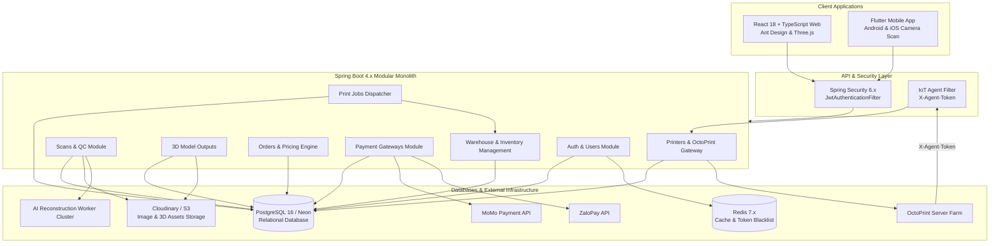
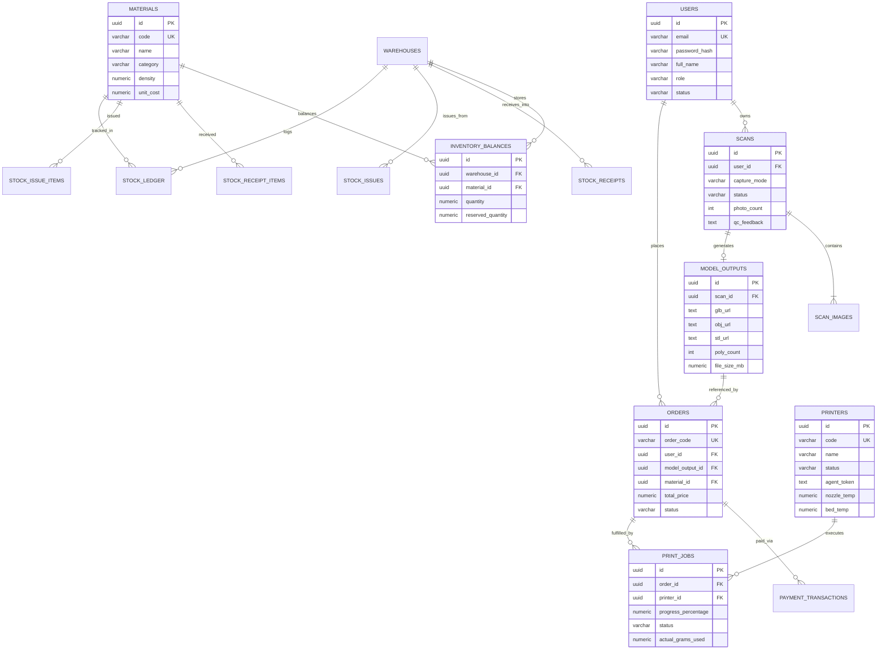
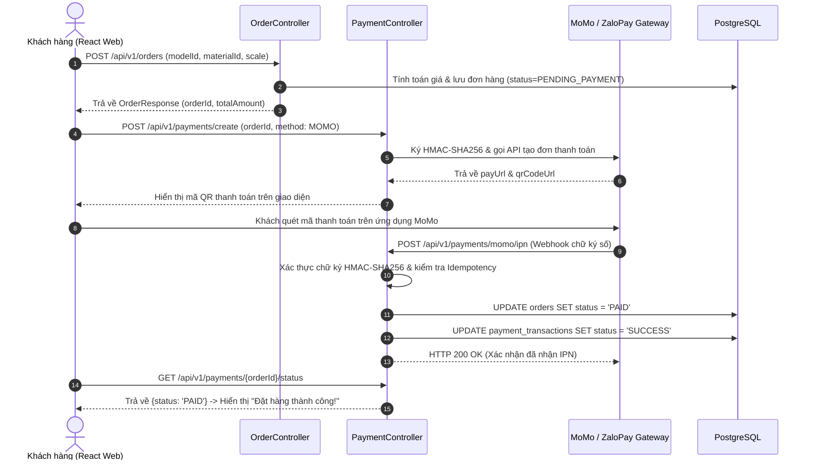

# MEMENTO3D — THE COMPREHENSIVE DEVELOPER GUIDE & ARCHITECTURE BIBLE
> **Tài liệu bàn giao & Hướng dẫn kỹ thuật toàn diện dành cho Kỹ sư phần mềm mới gia nhập dự án**  
> **Phiên bản**: 2.5 (Tháng 10/2026)  
> **Tác giả**: Principal Software Architect & Tech Lead  
> **Trạng thái**: Hoàn thiện & Khớp 100% với mã nguồn thực tế

---

## MỤC LỤC TỔNG QUAN
1. [Giới thiệu Dự án Memento3D & Phạm vi Nghiệp vụ](#1-giới-thiệu-dự-án-memento3d--phạm-vi-nghiệp-vụ)
2. [Vai trò & Bảng Phân quyền Thực tế (Actors & RBAC Matrix)](#2-vai-trò--bảng-phân-quyền-thực-tế-actors--rbac-matrix)
3. [Kiến trúc Hệ thống (System Architecture & Modular Monolith)](#3-kiến-trúc-hệ-thống-system-architecture--modular-monolith)
4. [Cơ sở Dữ liệu & Sơ đồ Thực thể Quan hệ (Database & ERD)](#4-cơ-sở-dữ-liệu--sơ-đồ-thực-thể-quan-hệ-database--erd)
5. [Cơ chế Xác thực & Bảo mật (Authentication & Security)](#5-cơ-chế-xác-thực--bảo-mật-authentication--security)
6. [Danh mục Toàn bộ REST APIs (API Reference)](#6-danh-mục-toàn-bộ-rest-apis-api-reference)
7. [Các Luồng Nghiệp vụ Cốt lõi & Sequence Diagrams](#7-các-luồng-nghiệp-vụ-cốt-lõi--sequence-diagrams)
8. [Tích hợp Ngoại vi (External Integrations: Cloud, Gateways, IoT)](#8-tích-hợp-ngoại-vi-external-integrations)
9. [Cấu hình Môi trường & Hướng dẫn Chạy Local](#9-cấu-hình-môi-trường--hướng-dẫn-chạy-local)
10. [Chiến lược Kiểm thử & Tài khoản Test có sẵn](#10-chiến-lược-kiểm-thử--tài-khoản-test-có-sẵn)
11. [Xử lý Sự cố & Lỗi Thường gặp (Troubleshooting)](#11-xử-lý-sự-cố--lỗi-thường-gặp-troubleshooting)
12. [Đánh giá Lỗ hổng Kỹ thuật (Technical Debt) & Roadmap Phát triển](#12-đánh-giá-lỗ-hổng-kỹ-thuật-technical-debt--roadmap-phát-triển)

---

## 1. GIỚI THIỆU DỰ ÁN MEMENTO3D & PHẠM VI NGHIỆP VỤ

### 1.1 Memento3D là gì?
**Memento3D** là nền tảng thương mại điện tử kết hợp công nghệ cao (DeepTech SaaS & Manufacturing), cho phép người dùng biến các bức ảnh chụp kỷ niệm 2D (chân dung, gia đình, thú cưng, kỷ vật) thành các **mô hình vật lý 3D cá nhân hóa** thông qua quy trình:
1. **Chụp & Tải ảnh đa góc** (Photogrammetry 20 - 200 ảnh).
2. **Kiểm duyệt chất lượng ảnh đầu vào (QC Gate)** bởi kỹ thuật viên.
3. **Tái tạo mô hình 3D bằng Trí tuệ nhân tạo** (AI 3D Reconstruction: SfM + MVS + Meshing).
4. **Xem trước 3D tương tác** trên trình duyệt Web (Three.js WebGL).
5. **Cấu hình & Đặt in 3D**: Chọn vật liệu (PLA, Resin, TPU), độ đặc ruột, kích thước và màu sắc.
6. **Thanh toán trực tuyến** qua MoMo hoặc ZaloPay.
7. **Sản xuất tự động tại Trang trại In 3D (3D Print Farm)** thông qua cổng điều khiển IoT OctoPrint.
8. **Quản lý Kho vật liệu & Định mức (WMS)** tự động trừ kho khi in xong.
9. **Đóng gói & Giao nhận thành phẩm tận nơi**.

### 1.2 Làm rõ Phạm vi Thực tế (Crucial Scope Distinction)
> [!IMPORTANT]
> **Xác nhận phạm vi source code:**
> - Dự án tập trung 100% vào chuỗi sản xuất chế tác in 3D cá nhân hóa.
> - **Module Đặt chuyến đi / Tài xế chở khách (Booking / Passenger Ride-Hailing) HOÀN TOÀN KHÔNG TỒN TẠI** trong source code (`STATUS: NOT FOUND`).
> - Vai trò `ROLE_DRIVER` nếu được kích hoạt trong hệ thống là đối tác **Giao nhận kiện hàng mô hình 3D (Last-mile Delivery)** từ xưởng in tới khách hàng.

---

## 2. VAI TRÒ & BẢNG PHÂN QUYỀN THỰC TẾ (ACTORS & RBAC MATRIX)

Hệ thống định nghĩa 7 vai trò trong Enum `com.memento3d.auth.domain.model.Role`:

| Role | Tên hiển thị | Trách nhiệm chính | Quyền hạn tiêu biểu |
|---|---|---|---|
| `ROLE_CUSTOMER` | Khách hàng | Tạo bản scan ảnh, duyệt xem 3D, đặt đơn in, thanh toán MoMo/ZaloPay | Quản lý dữ liệu cá nhân mình tạo ra |
| `ROLE_OPERATOR` | Kỹ thuật viên | Kiểm duyệt QC ảnh scan, điều phối máy in 3D, cắt file G-code, giám sát in | Truy cập QC Queue, Printer Farm, Print Jobs, WMS |
| `ROLE_MANAGER` | Quản lý xưởng | Duyệt đơn hàng lớn, phân bổ máy in, quản lý kho vật liệu và thiết bị | Toàn quyền vận hành sản xuất và kho bãi |
| `ROLE_WAREHOUSE`| Thủ kho | Nhập kho theo lô, xuất kho phế phẩm, kiểm kê số dư tồn kho, xem sổ nhật ký | Quản trị phân hệ WMS `/api/v1/wms/**` |
| `ROLE_ADMIN` | Quản trị viên | Quản trị tài khoản, phân quyền, cấu hình hệ thống, xem toàn bộ log | Toàn quyền (Super User) trên tất cả các API |
| `ROLE_PROVIDER` | Đối tác in | Tiếp nhận các đơn in gia công được Memento3D điều phối khi xưởng quá tải | Xem đơn hàng gán cho mình, cập nhật tiến độ |
| `ROLE_DRIVER` | Shipper giao hàng| Nhận kiện hàng đã in và đóng gói (`READY_FOR_SHIPPING`) để giao cho khách | Xem đơn hàng cần giao, cập nhật đã giao |

---

## 3. KIẾN TRÚC HỆ THỐNG (SYSTEM ARCHITECTURE & MODULAR MONOLITH)

Memento3D được thiết kế theo mô hình **Modular Monolith** kết hợp nguyên tắc **Package-by-Feature**:



---

## 4. CƠ SỞ DỮ LIỆU & SƠ ĐỒ THỰC THỂ QUAN HỆ (DATABASE & ERD)

Toàn bộ hệ thống quản lý 22 bảng cơ sở dữ liệu trên PostgreSQL:



---

## 5. CƠ CHẾ XÁC THỰC & BẢO MẬT (AUTHENTICATION & SECURITY)

- **JWT Dual Token Pattern**:
  - `Access Token`: Hạn dùng 1 giờ, ký HMAC-SHA256, gửi qua header `Authorization: Bearer <token>`.
  - `Refresh Token`: Hạn dùng 30 ngày, lưu trong bảng `users` và LocalStorage để tự động lấy lại Access Token mới khi gặp lỗi 401.
- **Redis Token Blacklist**:
  - Khi user chủ động bấm Logout (`POST /api/v1/auth/logout`), token được ghi vào Redis (`blacklist:token:<token>`) với TTL bằng thời gian còn lại. Filter sẽ chặn đứng ngay lập tức nếu kẻ gian cố tình dùng lại token này.
- **Google OAuth2**:
  - Client gửi `idToken` lên `POST /api/v1/auth/oauth2/google`. Backend sử dụng Google API Client để xác minh chữ ký từ Google, tự động tạo tài khoản Customer nếu là lần đầu đăng nhập.
- **OctoPrint IoT Agent Authentication**:
  - Sử dụng header `X-Agent-Token` được cấp riêng cho từng máy in để xác thực các luồng gửi telemetry và tiến độ in ấn mà không cần dùng JWT của người dùng.

---

## 6. DANH MỤC TOÀN BỘ REST APIS (API REFERENCE)

### Nhóm Xác thực (`/api/v1/auth`)
- `POST /api/v1/auth/register`: Đăng ký tài khoản Customer mới.
- `POST /api/v1/auth/login`: Đăng nhập bằng Email & Password.
- `POST /api/v1/auth/refresh`: Cấp lại Access Token mới bằng Refresh Token.
- `POST /api/v1/auth/oauth2/google`: Đăng nhập Google ID Token.
- `POST /api/v1/auth/logout`: Đăng xuất và thu hồi token vào Redis.
- `GET /api/v1/auth/me`: Lấy thông tin tài khoản hiện tại.

### Nhóm Scans & QC (`/api/v1/scans`)
- `POST /api/v1/scans/upload`: Tải lên tập ảnh scan (Multipart/form-data).
- `GET /api/v1/scans/{id}`: Xem chi tiết bản scan và danh sách ảnh.
- `GET /api/v1/scans/my`: Danh sách scan của khách hàng hiện tại.
- `GET /api/v1/scans/qc/queue`: (Operator) Hàng đợi ảnh chờ duyệt QC.
- `POST /api/v1/scans/qc/{id}/approve`: (Operator) Duyệt ảnh đạt chuẩn đẩy sang AI.
- `POST /api/v1/scans/qc/{id}/reject`: (Operator) Từ chối ảnh mờ/hỏng kèm lý do.

### Nhóm 3D Models (`/api/v1/models`)
- `GET /api/v1/models/scan/{scanId}`: Lấy link xem 3D GLB/OBJ/STL.
- `GET /api/v1/models/{id}/download`: Tải file 3D mesh gốc.

### Nhóm Đơn hàng (`/api/v1/orders`)
- `POST /api/v1/orders`: Tạo đơn đặt in mô hình 3D.
- `GET /api/v1/orders`: Danh sách đơn hàng (hỗ trợ phân trang và lọc status).
- `GET /api/v1/orders/{id}`: Chi tiết đơn hàng và lịch sử gia công.
- `PATCH /api/v1/orders/{id}/cancel`: Hủy đơn hàng (khi chưa in).

### Nhóm Thanh toán (`/api/v1/payments`)
- `POST /api/v1/payments/create`: Tạo phiên thanh toán MoMo / ZaloPay.
- `POST /api/v1/payments/momo/ipn`: Webhook nhận kết quả MoMo (HMAC-SHA256).
- `POST /api/v1/payments/zalopay/callback`: Webhook nhận kết quả ZaloPay.
- `GET /api/v1/payments/{orderId}/status`: Kiểm tra trạng thái giao dịch.

### Nhóm Máy in & IoT Agent (`/api/v1/printers`)
- `GET /api/v1/printers`: Danh sách máy in và trạng thái kết nối.
- `POST /api/v1/printers`: Thêm máy in mới và sinh `agentToken`.
- `POST /api/v1/printers/agent/heartbeat`: IoT Agent ping 15s xác nhận online.
- `POST /api/v1/printers/agent/telemetry`: Cập nhật nhiệt độ đầu đùn và bàn in.
- `POST /api/v1/printers/agent/job-progress`: Cập nhật tiến độ in (Layer, %).

### Nhóm Điều phối Lệnh in (`/api/v1/print-jobs`)
- `POST /api/v1/print-jobs`: Tạo lệnh in cho đơn hàng.
- `POST /api/v1/print-jobs/{id}/assign`: Gán máy in cho lệnh in.
- `POST /api/v1/print-jobs/{id}/start`: Bắt đầu in và bắn G-code sang máy.
- `POST /api/v1/print-jobs/{id}/complete`: Hoàn thành in và trừ kho vật liệu.

### Nhóm Quản trị Kho WMS (`/api/v1/wms`)
- `GET /api/v1/wms/warehouses`: Danh sách các kho đang hoạt động.
- `GET /api/v1/wms/materials`: Danh mục vật liệu (PLA, ABS, Resin, Silk).
- `POST /api/v1/wms/materials`: Khai báo mã vật liệu mới.
- `GET /api/v1/wms/inventory`: Số dư tồn kho tức thời.
- `POST /api/v1/wms/receipts`: Lập phiếu nhập kho theo lô.
- `POST /api/v1/wms/issues`: Lập phiếu xuất kho.
- `GET /api/v1/wms/ledger`: Sổ nhật ký xuất nhập tồn chi tiết.

---

## 7. CÁC LUỒNG NGHIỆP VỤ CỐT LÕI & SEQUENCE DIAGRAMS

### 7.1 Luồng Khởi tạo & Thanh toán Đơn hàng (End-to-End)


---

## 8. TÍCH HỢP NGOẠI VI (EXTERNAL INTEGRATIONS)

1. **Neon Serverless PostgreSQL**:
   - Sử dụng kết nối bảo mật `sslmode=require`.
   - Kết nối thông qua Neon Connection Pooler để xử lý tải cao mà không làm cạn kiệt pool kết nối.
2. **Redis (Port 6379)**:
   - Lưu trữ danh sách đen Token thu hồi (`Token Blacklist`).
   - Caching danh mục vật liệu và cấu hình máy in.
3. **Cloudinary / Cloud Storage**:
   - Lưu trữ an toàn các bức ảnh gốc độ phân giải cao do khách hàng tải lên.
   - Lưu trữ file thành phẩm 3D Mesh (.glb, .obj, .stl) và ảnh thumbnail hiển thị.
4. **Cổng thanh toán MoMo & ZaloPay**:
   - Ký và xác thực chữ ký điện tử HMAC-SHA256 trên mọi payload giao dịch.
   - Cơ chế xử lý Webhook Idempotent ngăn ngừa việc ghi nhận nạp tiền nhiều lần.
5. **OctoPrint 3D Printer Farm**:
   - Giao tiếp qua HTTP REST và WebSocket.
   - Định danh qua `X-Agent-Token`.

---

## 9. CẤU HÌNH MÔI TRƯỜNG & HƯỚNG DẪN CHẠY LOCAL

### 9.1 Khởi động Redis
```powershell
docker run -d --name memento3d-redis -p 6379:6379 redis:7-alpine
```

### 9.2 Khởi động Backend (Spring Boot)
```powershell
cd Memento3D-Backend\memeto3D
.\mvnw clean compile -DskipTests
.\mvnw spring-boot:run
```
- API Base: `http://localhost:8080/api/v1`
- Swagger UI: `http://localhost:8080/swagger-ui/index.html`

### 9.3 Khởi động Frontend (React Vite)
```powershell
cd Memento3D-Fronted-Web
npm install
npm run dev
```
- Web Application: `http://localhost:5173` (hoặc `http://localhost:5174`)

---

## 10. CHIẾN LƯỢC KIỂM THỬ & TÀI KHOẢN TEST CÓ SẴN

Hệ thống đã kích hoạt sẵn tài khoản demo (`email_verified = true`, `status = ACTIVE`) với mật khẩu chung: **`123456`**.

| Actor (Tác nhân) | Role Code | Cổng đăng nhập | Email chính thức | Email phụ | Mật khẩu | Không gian đích |
|---|---|---|---|---|---|---|
| **Khách hàng** | `ROLE_USER` | `/login` | `customer@memento3d.vn` | `user@memento3d.com` | `123456` | `/customer/home` |
| **Quản trị viên** | `ROLE_ADMIN` | `/admin/login` | `admin@memento3d.vn` | `admin@memento3d.com` | `123456` | `/admin/home` |
| **Quản lý Vận hành** | `ROLE_MANAGER` | `/manager/login` | `manager@memento3d.vn` | `manager@memento3d.com` | `123456` | `/manager/home` |
| **Thủ kho WMS** | `ROLE_WAREHOUSE` | `/warehouse/login` | `warehouse@memento3d.vn` | `warehouse@memento3d.com` | `123456` | `/warehouse/home` |
| **Kỹ thuật viên In** | `ROLE_OPERATOR` | `/operator/login` | `operator@memento3d.vn` | `operator@memento3d.com` | `123456` | `/operator/home` |
| **Đối tác Xưởng in** | `ROLE_PROVIDER` | `/provider/login` | `provider@memento3d.vn` | `provider@memento3d.com` | `123456` | `/provider/home` |
| **Tài xế Giao vận** | `ROLE_DRIVER` | `/driver/login` | `driver@memento3d.vn` | `driver@memento3d.com` | `123456` | `/driver/home` |

---

## 11. XỬ LÝ SỰ CỐ & LỖI THƯỜNG GẶP (TROUBLESHOOTING)

### 11.1 Cổng 8080 bị chiếm dụng (Port 8080 in use)
```powershell
Get-NetTCPConnection -LocalPort 8080 -ErrorAction SilentlyContinue | ForEach-Object { Stop-Process -Id $_.OwningProcess -Force }
```

### 11.2 Lỗi Compiler Eclipse JDT ("Flexible constructor bodies")
Lỗi xảy ra do plugin VS Code / Eclipse Java tự build đè file `.class` lỗi vào thư mục `target/classes`.
Khắc phục:
```powershell
cd Memento3D-Backend\memeto3D
.\mvnw clean compile -DskipTests
```

### 11.3 Lỗi Banner đỏ "Warehouse Access Denied"
Đã được sửa trong `WarehouseSecurityService.java`: Quản trị viên (`ADMIN`), Quản lý (`MANAGER`) và Kỹ thuật viên (`OPERATOR`) được cấp quyền truy cập toàn diện tất cả các kho đang hoạt động mà không bị chặn phân bổ đơn lẻ.

---

## 12. ĐÁNH GIÁ LỖ HỔNG KỸ THUẬT (TECHNICAL DEBT) & ROADMAP PHÁT TRIỂN

### 12.1 Bảng Phân loại Lỗ hổng Kỹ thuật (Technical Debt)

| Mức độ | Vấn đề phát hiện | Tác động | Khuyến nghị khắc phục |
|---|---|---|---|
| **P1** | Chưa lưu `agent_token` dưới dạng Hash trong DB | Lộ token kết nối máy in nếu cơ sở dữ liệu bị rò rỉ | Chuyển sang lưu `BCrypt` hash cho `agent_token` |
| **P1** | Thiếu Rate Limiting trên API Upload & Login | Nguy cơ bị tấn công Brute-force hoặc làm tràn bộ nhớ Cloud Storage | Tích hợp Bucket4j với Redis rate limiter |
| **P2** | Chưa có kiểm thử tự động tải đồng thời (Race condition) trên Webhook IPN | Nguy cơ xử lý đơn hàng trùng lặp nếu gateway bắn nhiều IPN | Bổ sung Pessimistic Locking trên `orders.status` |
| **P3** | Frontend hiển thị hardcoded URL trong một số component cũ | Khó khăn khi đổi domain production | Chuyển 100% sang biến môi trường `import.meta.env` |

### 12.2 Roadmap Kỹ thuật 4 Giai đoạn
1. **Giai đoạn 1 (Hiện tại)**: Ổn định bảo mật, nâng độ phủ Unit Test lên 70%, hoàn thiện tài liệu Developer Guide.
2. **Giai đoạn 2 (Q4/2026)**: Triển khai IoT Agent thực tế trên trang trại 20 máy in OctoPrint và tích hợp Obico AI Spaghetti Detection.
3. **Giai đoạn 3 (Q1/2027)**: Tối ưu cụm GPU AI Reconstruction (NeRF / Gaussian Splatting) rút ngắn thời gian xử lý ảnh xuống dưới 3 phút.
4. **Giai đoạn 4 (Q2/2027)**: Kết nối tự động hóa giao vận với Giao Hàng Nhanh / Viettel Post và mở rộng mạng lưới xưởng in vệ tinh.
