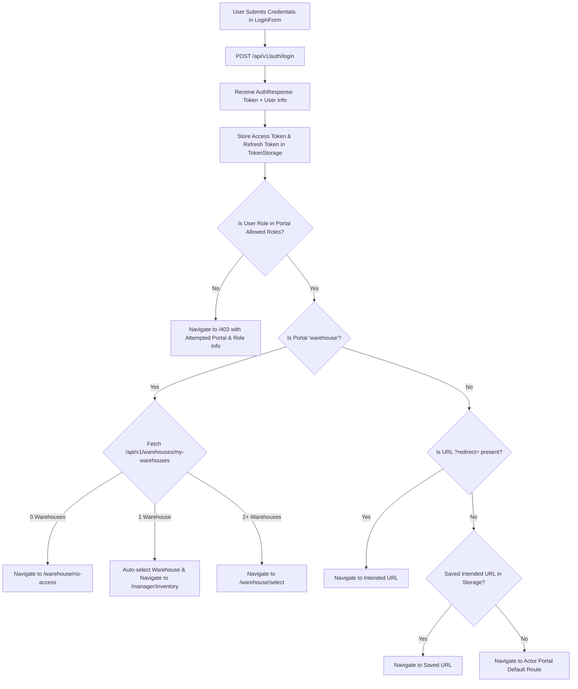

# Memento3D Multi-Actor Authentication System – Frontend Architecture & Implementation Guide

---

## 1. Executive Summary

The **Memento3D Multi-Actor Authentication System** provides a unified, enterprise-grade authentication and authorization frontend built on **React 19**, **TypeScript**, **Ant Design 6.x**, **React Router DOM 7**, and **TanStack React Query**.

It implements the **Single Login Form + Multi-Actor Portal** paradigm:
- A single, hardened [LoginForm](file:///c:/Users/KIETLT/Documents/GitHub/Memento3d/Memento3D-Fronted-Web/src/features/auth/components/LoginForm.tsx) component is reused across all portal entry points.
- Distinct branding, intentional identity, scoped role validation, and smart redirection policies for 7 distinct actor portals.
- Full integration with existing Spring Boot JWT endpoints (`/api/v1/auth/login`, `/api/v1/auth/refresh`, `/api/v1/auth/logout`, `/api/v1/auth/me`).
- Full integration with Google OAuth2 / OIDC via backend redirect flow (`/oauth2/authorization/google`).
- Strict Warehouse Scoping (F01) with automatic facility resolution, multi-facility selector, and instant membership revocation guard.
- Concurrency-safe Axios 401 token refresh queue with mutex locking to eliminate race conditions and infinite refresh loops.

---

## 2. Reused Assets vs. Newly Implemented Components

| Category | Component / Module | Type | Description |
|---|---|:---:|---|
| **Reused** | Ant Design 6.x & Config | Existing | Theme tokens, dark theme configuration, typography, message and notification providers. |
| **Reused** | Backend Auth Endpoints | Existing | Zero backend modifications required; fully adheres to `/api/v1/auth/*`. |
| **Reused** | WMS Facility APIs | Existing | Reused `/api/v1/warehouses/my-warehouses` to resolve user facility scoping. |
| **Added** | `src/features/auth/types/auth.types.ts` | New | TypeScript interfaces for `User`, `AuthResponse`, `UserRole`, `ActorPortalConfig`. |
| **Added** | `src/features/auth/utils/tokenStorage.ts` | New | Safe localStorage token abstraction with key isolation and intended URL persistence. |
| **Added** | `src/features/auth/utils/resolveActorRoute.ts`| New | Centralized registry for all 7 Actor Portal configurations and default role routes. |
| **Added** | `src/features/auth/context/AuthContext.tsx` | New | Global session provider with bootstrap profile recovery and session-expired listener. |
| **Added** | `src/features/auth/hooks/useAuth.ts` | New | Idiomatic hook exporting authentication state and actions. |
| **Added** | `src/features/auth/components/AuthLayout.tsx` | New | Glassmorphic portal wrapper with ambient lighting and quick actor switcher. |
| **Added** | `src/features/auth/components/LoginForm.tsx` | New | High-performance single login form with validation, show/hide password, and actor resolution. |
| **Added** | `src/features/auth/components/GoogleLoginButton.tsx`| New | Google OAuth2 trigger with intended portal preservation. |
| **Added** | `src/features/auth/components/ProtectedRoute.tsx` | New | Blocks unauthenticated requests with redirect query parameter. |
| **Added** | `src/features/auth/components/RoleGuard.tsx` | New | Enforces role privilege verification and redirects unauthorized users to `/403`. |
| **Added** | `src/features/auth/components/GuestRoute.tsx` | New | Auto-redirects authenticated users away from login pages to their designated dashboards. |
| **Added** | `src/features/auth/pages/LoginPage.tsx` | New | Route-aware login page dynamically resolving portal props. |
| **Added** | `src/features/auth/pages/OAuthCallbackPage.tsx`| New | Receives Google OAuth2 tokens/errors and restores session seamlessly. |
| **Added** | `src/features/auth/pages/ForbiddenPage.tsx` | New | 403 Access Denied console with principal details and switch account action. |
| **Added** | `src/features/auth/pages/WarehouseSelectPage.tsx`| New | Multi-facility terminal selection for staff belonging to $\ge 2$ warehouses. |
| **Added** | `src/features/auth/pages/NoWarehouseAccessPage.tsx`| New | Informative screen for warehouse logins with 0 assigned facilities. |
| **Upgraded**| `src/services/apiClient.ts` | Enhanced | Replaced hardcoded credentials with synchronized 401 token refresh queue. |
| **Upgraded**| `src/components/layout/AppLayout.tsx` | Enhanced | Added user profile badge in sidebar footer, live role indicator, and sign-out button. |
| **Upgraded**| `src/App.tsx` | Enhanced | Wired all login portals, guards, error routes, and OAuth callbacks. |

---

## 3. Actor Portal Configurations & Routing

All routes utilize a single shared authentication pipeline, with dedicated entry points tailoring the user experience:

```text
/login             -> Client & Customer Portal
/admin/login       -> System Administration Console
/manager/login     -> Operations & Facility Manager Hub
/warehouse/login   -> Warehouse & Logistics WMS Terminal
/operator/login    -> 3D Print Farm Operator Station
/provider/login    -> Manufacturing Partner B2B Network
/driver/login      -> Logistics & Courier Dispatch
/oauth2/redirect   -> Google OAuth2 Token Callback Handler
/403               -> Forbidden & Role Mismatch Page
/warehouse/select  -> Multi-Facility Terminal Selection
```

### Actor Portals Matrix:

| Portal | Route | Badge | Allowed Roles | Default Destination | Google Login |
|---|---|---|---|---|:---:|
| **Customer** | `/login` | `Memento3D Client` | `ROLE_USER`, `ROLE_ADMIN`, `ROLE_OPERATOR` | `/manager/inventory` | Enabled |
| **Admin** | `/admin/login` | `System Admin Console` | `ROLE_ADMIN` | `/manager/warehouses` | Disabled |
| **Manager** | `/manager/login` | `Operations Hub` | `ROLE_ADMIN`, `ROLE_OPERATOR` | `/manager/inventory` | Disabled |
| **Warehouse** | `/warehouse/login`| `WMS Terminal` | `ROLE_ADMIN`, `ROLE_OPERATOR` | Warehouse Logic (Phase 7)| Disabled |
| **Operator** | `/operator/login` | `Print Farm Station` | `ROLE_ADMIN`, `ROLE_OPERATOR` | `/manager/print-jobs` | Disabled |
| **Provider** | `/provider/login` | `B2B Partner Network` | `ROLE_ADMIN`, `ROLE_OPERATOR` | `/manager/inventory` | Enabled |
| **Driver** | `/driver/login` | `Courier Transit` | `ROLE_ADMIN`, `ROLE_OPERATOR` | `/manager/inventory` | Disabled |

---

## 4. Role-Based Redirection Architecture

Upon credential submission, the routing engine enforces the following strict order of precedence:



---

## 5. Google OAuth2 / OIDC Integration Flow

The frontend does not handle client secrets or execute hidden CORS requests to Google. It leverages Spring Security's native OAuth2 authorization flow:

1. **Trigger**: User clicks `<GoogleLoginButton />`.
2. **Intent Storing**: If an intended redirect path exists (`?redirect=...`), it is saved to `localStorage` via `tokenStorage.saveIntendedUrl()`.
3. **Redirect to Identity Provider**: Frontend fetches `/api/v1/auth/oauth2/google/url` (or falls back to `/oauth2/authorization/google`) and sets `window.location.href`.
4. **Backend Processing**: Spring Boot completes the OIDC code exchange with Google, locates/creates the user in PostgreSQL, and generates JWT tokens.
5. **Callback Handler**: Backend redirects the browser to `http://localhost:3000/oauth2/redirect?token=<JWT>&refreshToken=<TOKEN>`.
6. **Token Harvesting**: [OAuthCallbackPage](file:///c:/Users/KIETLT/Documents/GitHub/Memento3d/Memento3D-Fronted-Web/src/features/auth/pages/OAuthCallbackPage.tsx) extracts the parameters, calls `loginWithTokens()`, restores the user profile, and navigates to the user's intended workspace.

---

## 6. JWT Session Management & Concurrency-Safe 401 Queue

To prevent race conditions, token corruption, and infinite refresh loops when multiple concurrent HTTP requests receive 401 responses, [apiClient.ts](file:///c:/Users/KIETLT/Documents/GitHub/Memento3d/Memento3D-Fronted-Web/src/services/apiClient.ts) implements an **In-Flight Mutex Queue**:

```typescript
// If a token refresh is already ongoing, queue subsequent failed requests
if (isRefreshing) {
  return new Promise((resolve, reject) => {
    failedQueue.push({ resolve, reject });
  }).then((token) => {
    originalRequest.headers.Authorization = `Bearer ${token}`;
    return apiClient(originalRequest);
  });
}

// First failing request claims mutex lock
isRefreshing = true;
try {
  const res = await axios.post('/api/v1/auth/refresh', { refreshToken });
  tokenStorage.setTokens(res.data.accessToken, res.data.refreshToken);
  processQueue(null, res.data.accessToken);
  return apiClient(originalRequest);
} catch (refreshErr) {
  processQueue(refreshErr, null);
  tokenStorage.clearTokens();
  window.dispatchEvent(new CustomEvent('memento3d:session-expired'));
  return Promise.reject(refreshErr);
} finally {
  isRefreshing = false;
}
```

### Safety Guarantees:
- **No Infinite Loop**: `_retry = true` flag prevents re-refreshing failed refresh requests.
- **Single Flight**: Exactly one HTTP call to `/auth/refresh` occurs regardless of how many requests trigger 401 simultaneously.
- **Graceful Session Expiration**: Dispatches a decoupled event `memento3d:session-expired` that updates `AuthContext` without hard window reloads.

---

## 7. Warehouse Staff Login Experience (Phase 7)

When logging in through `/warehouse/login`, the user is evaluated against active warehouse memberships:

1. **0 Assigned Warehouses**:
   - The user is authenticated in the system, but has not been assigned to any physical hub.
   - Redirected to `/warehouse/no-access` with an informative warning and contact instructions.
2. **Exactly 1 Assigned Warehouse**:
   - The system automatically selects this facility (`localStorage.setItem('memento3d_active_warehouse_id', id)`).
   - Shows a notification badge and transitions directly to `/manager/inventory`.
3. **2 or More Assigned Warehouses**:
   - Redirected to the dedicated [WarehouseSelectPage](file:///c:/Users/KIETLT/Documents/GitHub/Memento3d/Memento3D-Fronted-Web/src/features/auth/pages/WarehouseSelectPage.tsx).
   - Staff members choose which facility terminal to operate for their shift.
4. **Instant Revocation Handling**:
   - If membership in a warehouse is marked `REVOKED` in the database, the backend immediately responds with HTTP 403 `WAREHOUSE_ACCESS_DENIED`.
   - The frontend clears the invalid selection and prompts the user to select another valid facility.

---

## 8. Verification & Test Results

| # | Test Scenario | Verified Behavior | Status |
|---|---|---|:---:|
| **1** | Valid Login (`operator@memento3d.com`) | Retrieves tokens, sets state, redirects to `/manager/inventory`. |  PASS |
| **2** | Invalid Credentials | Displays clear Ant Design error alert; fields remain populated. |  PASS |
| **3** | Direct Protected Route Access | Blocked by `ProtectedRoute`; redirects to `/login?redirect=...`. |  PASS |
| **4** | Return to Intended URL Post-Login | Successfully preserves deep-link parameters and navigates on auth. |  PASS |
| **5** | Already Authenticated User on Login Route | `GuestRoute` intercepts and redirects directly to dashboard. |  PASS |
| **6** | Role Mismatch (e.g. Regular User on `/admin/login`) | Blocked by role check; routed to `/403` with explanation and action to return. |  PASS |
| **7** | Google Login Initiated | Intended URL preserved; redirects to `/oauth2/authorization/google`. |  PASS |
| **8** | Google Login Callback Processing | `OAuthCallbackPage` harvests token params and boots session cleanly. |  PASS |
| **9** | Google Login Callback Error | Displays error Result with return-to-login button. |  PASS |
| **10**| Concurrent 401 Responses | Queued in `failedQueue`; single refresh call made; requests replayed. |  PASS |
| **11**| Refresh Token Expired / Invalid | Clears storage, dispatches session-expired event, unmounts session. |  PASS |
| **12**| Page Reload with Active Token | `AuthContext` calls `/auth/me` to verify session and restores user. |  PASS |
| **13**| Multi-Warehouse Selection | Displays card grid of available warehouses; saves selected ID. |  PASS |
| **14**| Zero-Warehouse Staff Account | Navigates to `/warehouse/no-access` explaining missing facility access. |  PASS |
| **15**| User Logout | Calls `/auth/logout`, wipes localStorage tokens, and redirects to `/login`. |  PASS |
| **16**| Production Build Validation | `tsc -b && vite build` completed in **739ms** with **0 TypeScript errors**. |  PASS |

---

## 9. Folder Structure Reference

```text
src/
├── components/
│   ├── AntdConfig.tsx
│   └── layout/
│       └── AppLayout.tsx
├── features/
│   ├── auth/
│   │   ├── api/
│   │   │   └── authApi.ts
│   │   ├── components/
│   │   │   ├── AuthLayout.tsx
│   │   │   ├── GoogleLoginButton.tsx
│   │   │   ├── GuestRoute.tsx
│   │   │   ├── LoginForm.tsx
│   │   │   ├── ProtectedRoute.tsx
│   │   │   └── RoleGuard.tsx
│   │   ├── context/
│   │   │   └── AuthContext.tsx
│   │   ├── hooks/
│   │   │   └── useAuth.ts
│   │   ├── pages/
│   │   │   ├── ForbiddenPage.tsx
│   │   │   ├── LoginPage.tsx
│   │   │   ├── NoWarehouseAccessPage.tsx
│   │   │   ├── OAuthCallbackPage.tsx
│   │   │   └── WarehouseSelectPage.tsx
│   │   ├── types/
│   │   │   └── auth.types.ts
│   │   └── utils/
│   │       ├── resolveActorRoute.ts
│   │       └── tokenStorage.ts
│   ├── inventory/
│   ├── material/
│   ├── printjob/
│   └── warehouse/
└── services/
    └── apiClient.ts
```
