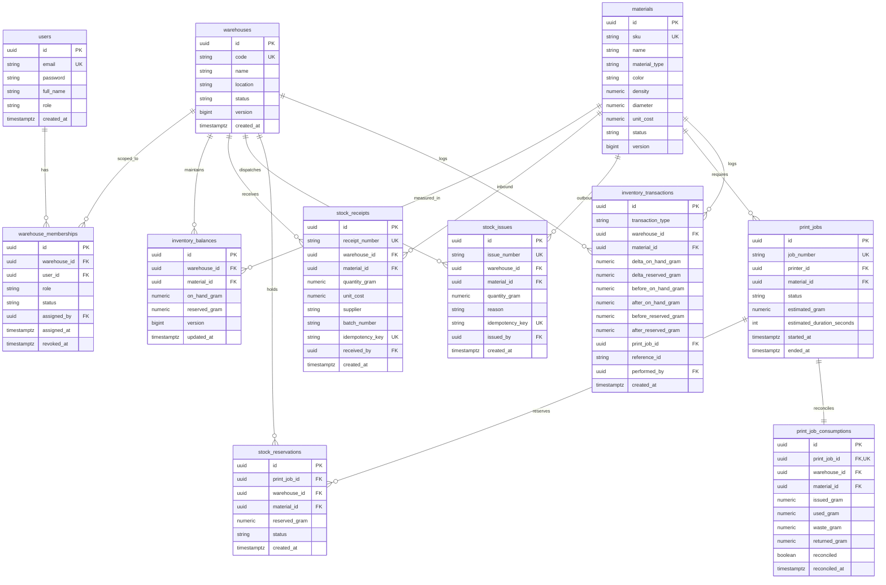
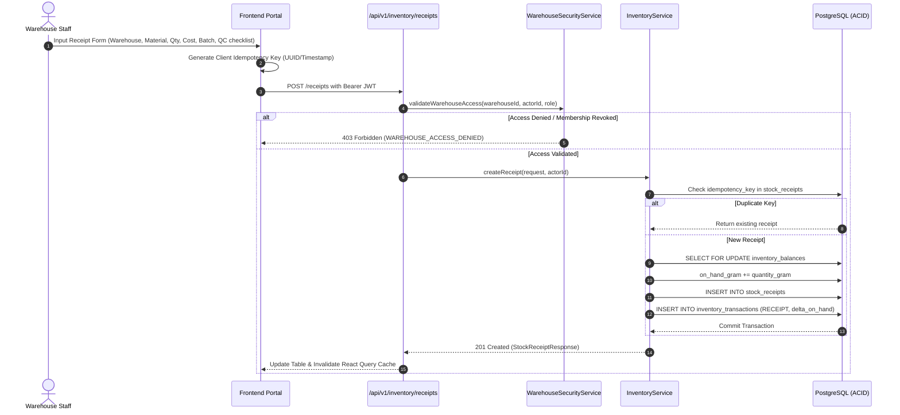
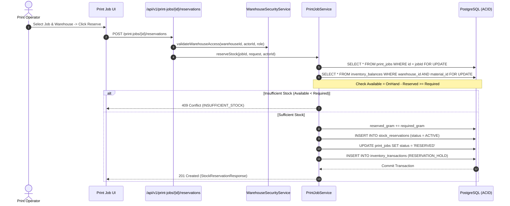
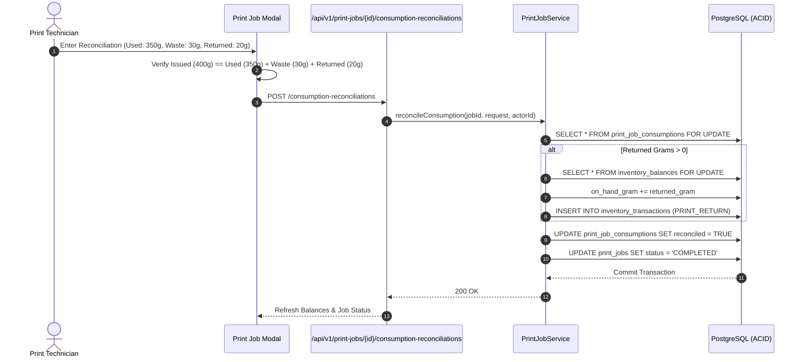
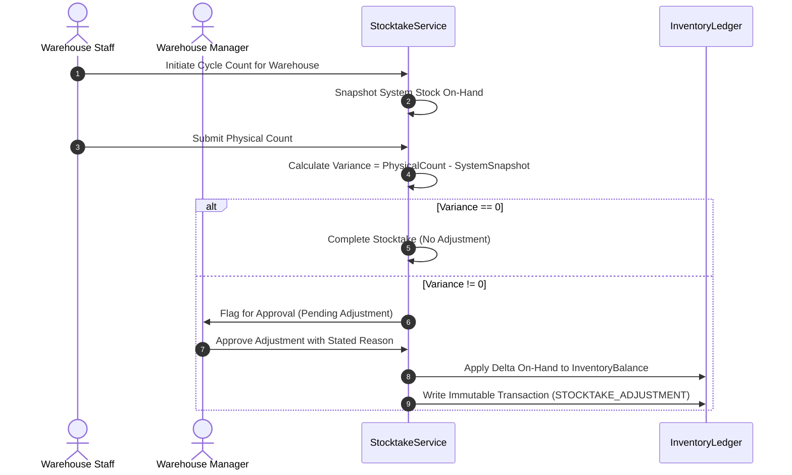

# Memento3D Warehouse Management System (WMS) – Technical Architecture & Implementation Guide

---

## 1. System Overview

**Memento3D WMS** is an enterprise-grade Inventory & Warehouse Management System tailored specifically for 3D printing manufacturing hubs, additive manufacturing facilities, and automated print farm clusters.

The system addresses the core operational lifecycle of 3D printing:
1. **Material Cataloging & Master Data**: Precise SKU tracking with polymer classifications (PLA, PETG, ABS, TPU, Resin), diameter (1.75mm / 2.85mm), density ($g/cm^3$), extrusion/bed thermal parameters, and cost per gram.
2. **Multi-Warehouse Access & Scoping (F01)**: Granular role-scoping ensuring regional operators, facility managers, and print technicians can only access facilities where they maintain an active warehouse membership.
3. **Goods Receiving & Quality Control (F03)**: Inbound material receipts with batch/lot tracking, spool inspection checklists, and quarantine mechanisms.
4. **Perpetual Inventory & Double-Entry Ledger (F04, F08)**: ACID-compliant on-hand and reserved balance tracking paired with an immutable append-only transaction ledger (`inventory_transactions`).
5. **Print Job Lifecycle Integration (F06, F07)**: Pessimistic locking for stock reservation prior to slicing/printing, material picking to physical printers, and 3-way reconciliation upon print completion (`Issued = Used + Waste + Returned`).
6. **Stocktaking & Variance Adjustments (F08)**: Blind/semi-blind cycle counts with dual-custody approval workflows preventing untracked inventory drift.

The platform is designed as a **Modular Monolith** using **Package-by-Feature** to keep development nimble and manageable by a lean team of 1 Backend Developer and 1 Frontend Developer.

---

## 2. Business Rules & Invariants

| ID | Rule Name | Description | Enforcing Layer |
|---|---|---|---|
| **BR-001** | **Strict Warehouse Scoping** | Non-admin users are strictly isolated to warehouses where they possess an `ACTIVE` membership. Membership revocation is instantaneous. | DB Check / `WarehouseSecurityService` |
| **BR-002** | **Unique Material SKU** | Material SKUs are case-insensitively unique across the entire organization. | DB Unique Index `uq_materials_sku_lower` |
| **BR-003** | **Non-Negative Inventory** | $OnHand \ge 0$, $Reserved \ge 0$, and $OnHand \ge Reserved$ at all times. | DB Check Constraints on `inventory_balances` |
| **BR-004** | **Available Stock Definition** | $Available = UsableOnHand - Reserved$. Quarantined and Rejected materials cannot be reserved or allocated for printing. | Application Service Logic |
| **BR-005** | **Zero Oversell Invariant** | Print job material reservation cannot exceed currently available stock. Simultaneous reservation attempts must acquire pessimistic locks (`SELECT ... FOR UPDATE`). | DB Row-Level Lock on `inventory_balances` |
| **BR-006** | **Idempotent Mutations** | Inbound stock receipts and manual stock issues require unique client-provided `idempotency_key` tokens to prevent duplicate submits. | DB Unique Constraints `uq_stock_receipts_idempotency` |
| **BR-007** | **Print Material Reconciliation** | For any completed or failed print job, $IssuedGram = UsedGram + WasteGram + ReturnedGram$. Returned grams automatically replenish usable stock on-hand. | DB Check Constraint `chk_consumptions_reconcile_formula` |
| **BR-008** | **Warehouse Deactivation Guard** | A warehouse cannot be marked `INACTIVE` if active stock on-hand or active reservations remain inside the facility. | `WarehouseServiceImpl.assertWarehouseCanBeDeactivated` |
| **BR-009** | **Append-Only Audit Ledger** | No record in `inventory_transactions` may be updated or deleted. Every mutation must record before/after balances, actor, and reference ID. | Immutable Ledger Service Pattern |
| **BR-010** | **Dual-Custody Adjustments** | Warehouse staff may record physical stocktake counts, but inventory variance adjustments require Manager or Admin approval before ledger posting. | Stocktake Service Workflow |

---

## 3. Role & Warehouse Permission Matrix

Memento3D uses a hybrid two-tier authorization model:
1. **System Roles**: `ROLE_ADMIN`, `ROLE_OPERATOR`, `ROLE_USER` (stored on the User account).
2. **Warehouse-Scoped Roles**: Stored in `warehouse_memberships` (`MANAGER`, `WAREHOUSE_STAFF`, `PRINT_OPERATOR`).

| Operation / Feature | System ADMIN | Warehouse MANAGER | WAREHOUSE_STAFF | PRINT_OPERATOR | Regular USER |
|---|:---:|:---:|:---:|:---:|:---:|
| **Create New Warehouse** |  Allowed | ❌ Forbidden | ❌ Forbidden | ❌ Forbidden | ❌ Forbidden |
| **Deactivate Warehouse** |  Allowed | ❌ Forbidden | ❌ Forbidden | ❌ Forbidden | ❌ Forbidden |
| **Assign / Revoke Warehouse Staff** |  Allowed |  Assigned WH Only | ❌ Forbidden | ❌ Forbidden | ❌ Forbidden |
| **View Warehouse Details & Staff** |  All WH |  Assigned WH Only |  Assigned WH Only | ❌ Forbidden | ❌ Forbidden |
| **Manage Material Catalog (SKU)** |  Allowed |  Allowed |  View Only |  View Only | ❌ Forbidden |
| **Create Goods Receipt (Stock In)** |  All WH |  Assigned WH Only |  Assigned WH Only | ❌ Forbidden | ❌ Forbidden |
| **Perform Manual Stock Issue** |  All WH |  Assigned WH Only |  Assigned WH Only | ❌ Forbidden | ❌ Forbidden |
| **Reserve Material for Print Job** |  All WH |  Assigned WH Only |  Assigned WH Only |  Assigned WH Only | ❌ Forbidden |
| **Issue Material to Printer** |  All WH |  Assigned WH Only |  Assigned WH Only |  Assigned WH Only | ❌ Forbidden |
| **Reconcile Print Consumption** |  All WH |  Assigned WH Only |  Assigned WH Only |  Assigned WH Only | ❌ Forbidden |
| **Initiate Stocktake & Count** |  All WH |  Assigned WH Only |  Assigned WH Only | ❌ Forbidden | ❌ Forbidden |
| **Approve Stocktake Variance** |  All WH |  Assigned WH Only | ❌ Forbidden | ❌ Forbidden | ❌ Forbidden |
| **View Ledger & Financial Reports** |  All WH |  Assigned WH Only | ❌ Forbidden | ❌ Forbidden | ❌ Forbidden |

---

## 4. Database Entity-Relationship Diagram (Mermaid ERD)



---

## 5. Warehouse Receiving Flow (F03)



---

## 6. Inventory Reservation Flow (F06)



---

## 7. Print Material Consumption Flow (F07)



---

## 8. Stocktake & Inventory Adjustment Flow (F08)



---

## 9. Inventory Health Formulas

$$\text{Available Stock} = \text{UsableOnHand} - \text{Reserved}$$

$$\text{Projected Balance} = \text{Available} + \text{ConfirmedInbound} - \text{UnreservedDemand}$$

$$\text{Replenishment Need} = \max(0, \text{SafetyStock} - \text{ProjectedBalance})$$

$$\text{Consumption Variance} = \text{ActualUsedGram} - \text{EstimatedGram}$$

$$\text{Material Waste Ratio} = \frac{\text{WasteGram}}{\text{IssuedGram}} \times 100\%$$

### Health Status State Machine:
- **`OUT_OF_STOCK`**: $\text{UsableOnHand} = 0$.
- **`SHORTAGE`**: $\text{Available} < \text{UnreservedDemand}$.
- **`AT_RISK`**: $\text{Available} < \text{SafetyStock}$.
- **`HEALTHY`**: $\text{SafetyStock} \le \text{Available} \le \text{MaxStock}$.
- **`OVERSTOCK`**: $\text{Available} > \text{MaxStock}$.

---

## 10. REST API Contract

### Group 1: Warehouse Facilities & Membership Scoping (F01)

| Method | Endpoint | Description | Auth Required |
|---|---|---|---|
| `POST` | `/api/v1/warehouses` | Register new warehouse facility | `ROLE_ADMIN` |
| `GET` | `/api/v1/warehouses` | List warehouses with search/status filters | `ADMIN`, `OPERATOR` |
| `GET` | `/api/v1/warehouses/my-warehouses` | Get warehouses accessible to current user | Authenticated |
| `GET` | `/api/v1/warehouses/{id}` | Get warehouse facility details | Member or Admin |
| `PATCH` | `/api/v1/warehouses/{id}` | Update warehouse name, code, location | Manager or Admin |
| `DELETE` | `/api/v1/warehouses/{id}` | Deactivate warehouse (requires 0 stock) | `ROLE_ADMIN` |
| `GET` | `/api/v1/warehouses/{id}/members` | List staff memberships for warehouse | Member or Admin |
| `POST` | `/api/v1/warehouses/{id}/members` | Assign staff member to warehouse | Manager or Admin |
| `DELETE` | `/api/v1/warehouses/{id}/members/{userId}` | Revoke staff membership from warehouse | Manager or Admin |

### Group 2: Materials Catalog (F02)

| Method | Endpoint | Description | Auth Required |
|---|---|---|---|
| `POST` | `/api/v1/materials` | Create new filament/resin SKU | `ADMIN`, `OPERATOR` |
| `GET` | `/api/v1/materials` | List materials with pagination & filters | `ADMIN`, `OPERATOR` |
| `GET` | `/api/v1/materials/{id}` | Get material SKU detail | `ADMIN`, `OPERATOR` |
| `PATCH` | `/api/v1/materials/{id}` | Update material specs or cost | `ADMIN`, `OPERATOR` |
| `DELETE` | `/api/v1/materials/{id}` | Deactivate material | `ADMIN`, `OPERATOR` |

### Group 3: Inventory Balances & Ledger Operations (F03, F04, F08)

| Method | Endpoint | Description | Auth Required |
|---|---|---|---|
| `GET` | `/api/v1/inventory/balances` | List stock balances by warehouse and SKU | Scoped Member |
| `POST` | `/api/v1/inventory/receipts` | Create inbound goods receipt | Scoped Member |
| `GET` | `/api/v1/inventory/receipts` | List past goods receipts | Scoped Member |
| `POST` | `/api/v1/inventory/issues` | Create manual stock issue | Scoped Member |
| `GET` | `/api/v1/inventory/issues` | List manual stock issues | Scoped Member |
| `GET` | `/api/v1/inventory/transactions` | Query immutable audit ledger transactions | Scoped Member |

### Group 4: Print Job Stock Allocation (F06, F07)

| Method | Endpoint | Description | Auth Required |
|---|---|---|---|
| `POST` | `/api/v1/print-jobs/{id}/reservations` | Reserve material for job | Scoped Member |
| `GET` | `/api/v1/print-jobs/{id}/reservations` | Get active job reservation | Scoped Member |
| `DELETE` | `/api/v1/print-jobs/{id}/reservations` | Release unfulfilled reservation | Scoped Member |
| `POST` | `/api/v1/print-jobs/{id}/material-issues` | Issue material to printer | Scoped Member |
| `POST` | `/api/v1/print-jobs/{id}/consumption-reconciliations` | Reconcile used/waste/returned | Scoped Member |
| `GET` | `/api/v1/print-jobs/{id}/material-consumption` | View consumption audit record | Scoped Member |

---

## 11. Backend Package Structure

```text
com.memento3d
├── identity
│   ├── api
│   ├── application.service
│   ├── domain.model
│   │   ├── AuthProvider.java
│   │   ├── Role.java
│   │   └── User.java
│   └── infrastructure.security
├── material
│   ├── api
│   ├── application.service
│   ├── domain.model
│   │   ├── Material.java
│   │   ├── MaterialStatus.java
│   │   └── MaterialType.java
│   └── infrastructure.persistence
├── warehouse
│   ├── api
│   │   ├── request
│   │   │   ├── AssignMemberRequest.java
│   │   │   ├── CreateWarehouseRequest.java
│   │   │   └── UpdateWarehouseRequest.java
│   │   ├── response
│   │   │   ├── WarehouseMembershipResponse.java
│   │   │   └── WarehouseResponse.java
│   │   └── WarehouseController.java
│   ├── application.service
│   │   ├── impl
│   │   │   └── WarehouseServiceImpl.java
│   │   ├── WarehouseSecurityService.java
│   │   └── WarehouseService.java
│   ├── domain.model
│   │   ├── MembershipStatus.java
│   │   ├── Warehouse.java
│   │   ├── WarehouseMembership.java
│   │   ├── WarehouseRole.java
│   │   └── WarehouseStatus.java
│   └── infrastructure.persistence.repository
│       ├── WarehouseMembershipRepository.java
│       └── WarehouseRepository.java
├── inventory
│   ├── api
│   │   ├── request
│   │   ├── response
│   │   └── InventoryController.java
│   ├── application.service
│   └── domain.model
└── printjob
    ├── api
    ├── application.service
    └── domain.model
```

---

## 12. Frontend Folder Structure

```text
src/
├── components/
│   ├── AntdConfig.tsx
│   └── layout/
│       └── AppLayout.tsx
├── features/
│   ├── material/
│   │   ├── api/
│   │   ├── components/
│   │   └── pages/
│   ├── warehouse/
│   │   ├── api/
│   │   │   └── warehouseApi.ts
│   │   ├── components/
│   │   │   ├── WarehouseFormModal.tsx
│   │   │   ├── WarehouseMembersDrawer.tsx
│   │   │   └── WarehouseSelector.tsx
│   │   ├── context/
│   │   │   └── WarehouseContext.tsx
│   │   ├── hooks/
│   │   │   └── useWarehouses.ts
│   │   ├── pages/
│   │   │   └── WarehouseManagementPage.tsx
│   │   └── types/
│   │       └── warehouse.types.ts
│   ├── inventory/
│   │   ├── api/
│   │   ├── components/
│   │   └── pages/
│   │       ├── StockIssuePage.tsx
│   │       ├── StockMovementReportPage.tsx
│   │       ├── StockReceiptPage.tsx
│   │       └── WarehouseDashboardPage.tsx
│   └── printjob/
│       ├── api/
│       ├── components/
│       └── pages/
└── services/
    └── apiClient.ts
```

---

## 13. Error Codes & HTTP Statuses

| Error Code | HTTP Status | Trigger Condition |
|---|:---:|---|
| `WAREHOUSE_ACCESS_DENIED` | `403 FORBIDDEN` | User does not have an active membership in the target warehouse |
| `WAREHOUSE_MANAGER_REQUIRED` | `403 FORBIDDEN` | Operation requires Warehouse Manager or System Admin role |
| `DUPLICATE_WAREHOUSE_CODE` | `409 CONFLICT` | Warehouse facility code already exists (case-insensitive) |
| `WAREHOUSE_HAS_STOCK` | `409 CONFLICT` | Attempted deactivation when warehouse still has stock on-hand |
| `WAREHOUSE_HAS_RESERVATIONS`| `409 CONFLICT` | Attempted deactivation when active print job reservations exist |
| `INSUFFICIENT_STOCK` | `409 CONFLICT` | Requested reservation or issue quantity exceeds available stock |
| `RECONCILIATION_MISMATCH` | `400 BAD_REQUEST` | $Issued \ne Used + Waste + Returned$ |
| `DUPLICATE_IDEMPOTENCY_KEY`| `409 CONFLICT` | Receipt or Issue with duplicate key |
| `RESOURCE_NOT_FOUND` | `404 NOT_FOUND` | Warehouse, Material, or User ID not found |

---

## 14. Test Cases & Verification Matrix

| # | Test Scenario | Level | Status |
|---|---|:---:|:---:|
| **TC-01** | Employee of Warehouse A cannot view/query Warehouse B | Backend Unit |  VERIFIED |
| **TC-02** | Revoking membership immediately blocks access even with valid unexpired JWT | Backend Unit |  VERIFIED |
| **TC-03** | System Admin bypasses warehouse membership requirement | Backend Unit |  VERIFIED |
| **TC-04** | Warehouse Manager can assign staff; regular staff cannot | Backend Unit |  VERIFIED |
| **TC-05** | Duplicate warehouse code throws 409 CONFLICT | Backend Unit |  VERIFIED |
| **TC-06** | Cannot deactivate warehouse with stock on-hand | Backend Unit |  VERIFIED |
| **TC-07** | Cannot deactivate warehouse with active reservations | Backend Unit |  VERIFIED |
| **TC-08** | Inbound receipt increases on-hand balance and writes ledger | Backend Unit |  VERIFIED |
| **TC-09** | Idempotent receipt returns existing record without double-counting | Backend Unit |  VERIFIED |
| **TC-10** | Stock reservation pessimistic locking holds reserved stock | Backend Unit |  VERIFIED |
| **TC-11** | Consumption reconciliation checks $Issued = Used + Waste + Returned$ | Backend Unit |  VERIFIED |
| **TC-12** | Returned print material replenishes warehouse on-hand stock | Backend Unit |  VERIFIED |
| **TC-13** | Frontend single warehouse auto-selects; multiple warehouses render selector | Frontend TS/Build |  VERIFIED |
| **TC-14** | Frontend unassigned user displays prominent Access Denied banner | Frontend TS/Build |  VERIFIED |

---

## 15. Deployment & Environment Configuration

### Database Environment:
- **PostgreSQL 14+**
- **Flyway Database Migrations**: Located at `src/main/resources/db/migration`
  - Current baseline: `V8__create_materials_warehouses_inventory_and_print_jobs.sql`
  - WMS Phase 1: `V9__create_warehouse_memberships_and_wms_phase1.sql`
- **Hibernate DDL Auto**: `validate` in production / local PostgreSQL; `create-drop` in H2 test profile.

### Backend Application Variables (`application.yml`):
```yaml
server:
  port: 8080
spring:
  datasource:
    url: jdbc:postgresql://${DB_HOST:localhost}:${DB_PORT:5432}/${DB_NAME:memento3d}
    username: ${DB_USERNAME:postgres}
    password: ${DB_PASSWORD:postgres}
  flyway:
    enabled: true
    locations: classpath:db/migration
```

### Frontend Application Variables (`.env`):
```bash
VITE_API_BASE_URL=http://localhost:8080/api/v1
```

---

## 16. Known Limitations & Remaining Tasks

### Completed in Phase 1:
- [x] Complete database schema for `warehouse_memberships` (Flyway `V9`).
- [x] Backend domain models (`WarehouseMembership`, `WarehouseRole`, `MembershipStatus`).
- [x] Backend `WarehouseSecurityService` enforcing access and manager checks.
- [x] Backend endpoints: `/my-warehouses`, `/{id}/members` (list, assign, revoke).
- [x] Warehouse access validation in `InventoryController` operations.
- [x] Frontend `WarehouseContext` with automatic single-warehouse selection and persistence.
- [x] Frontend `WarehouseSelector` topbar component.
- [x] Frontend `WarehouseMembersDrawer` with staff assignment and immediate revocation.
- [x] Comprehensive unit tests for security scoping and membership revocation.

### Remaining Tasks (Phase 2 - 5 Roadmap):
1. **Phase 2 (Material Catalog & Receiving)**:
   - Add safety stock, min stock, max stock fields to Material model.
   - Spool tracking (`material_spools`) with unique barcode/QR spool IDs.
   - QC status dropdown on Goods Receipt (`ACCEPTED`, `QUARANTINED`, `REJECTED`) and quarantine stock segregation.
2. **Phase 3 (Inventory & Replenishment Planning)**:
   - Implement Replenishment engine calculating $\max(0, SafetyStock - ProjectedBalance)$.
   - Frontend Inventory Health tab displaying SKU shortages and reorder recommendations.
3. **Phase 4 (Advanced Print Integration)**:
   - OctoPrint/Obico automatic telemetry consumption hook.
   - Spool picking workflow with barcode scanning.
4. **Phase 5 (Stocktake & Reporting)**:
   - Physical count stocktake session entity and approval workflow.
   - CSV export for inventory movement, consumption variance, and waste reports.
